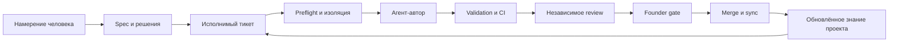
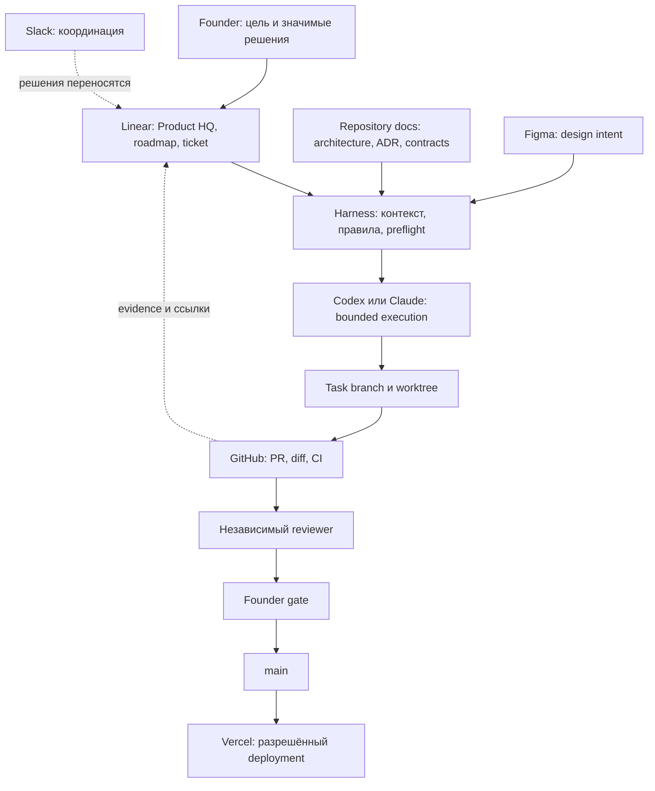
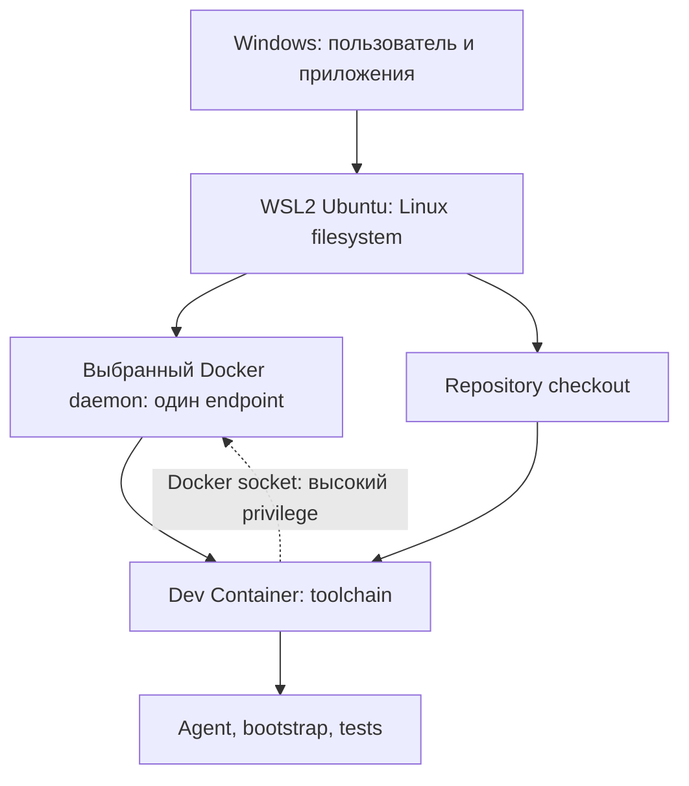
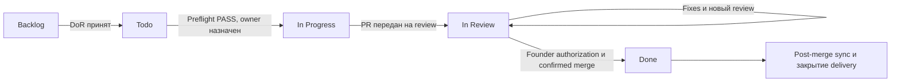
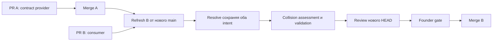
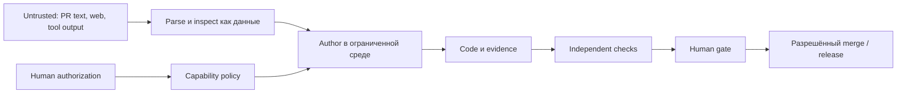

# ULTIMATE Vibe-coder guidebook [BETA]

> Практическое руководство: как перейти от диалога с AI-кодером к управляемой системе разработки. Принципы можно перенести в собственный проект.

**Версия:** 1.2 · **Дата подготовки:** 8 октября 2026 · **Язык:** русский.

**Для кого:** для человека, который уже пробовал vibe coding и хочет понять, как работать с несколькими агентами без потери контроля над требованиями, кодом и релизами.

**После чтения ты сможешь:** подготовить исполнимый тикет, выдать агенту ограниченный контракт, организовать параллельную работу, проверить результат независимо и безопасно интегрировать его.

## 00. Как читать и чему доверять

Три маршрута:

| Маршрут | Разделы | Результат |
|---|---|---|
| Понять систему | 01–03, 07, 22 | Картина целиком и рабочая памятка |
| Повторить у себя | 04–12, 14–17, 20 | Среда, правила, delivery и безопасность |
| Управлять несколькими агентами | 13, 18–19, 21 | Зависимости, восстановление, развитие orchestration |

### Границы применения

Это учебное руководство. Примеры и шаблоны нужно адаптировать к текущим правилам своего репозитория. Описанный процесс сам по себе не доказывает, что permissions, checks или gates уже автоматизированы: перед работой проверяй актуальные источники и реальные права.

### Навигация

- **Понять систему**

  - [От vibe coding к инженерной системе](#ch-01)
  - [Архитектура и источники истины](#ch-02)
  - [Agent harness](#ch-03)
  - [WSL2, Ubuntu и Dev Container](#ch-04)
  - [Роли Codex, Claude и человека](#ch-05)

- **Провести задачу**

  - [Тикет и Definition of Ready](#ch-06)
  - [Полный lifecycle](#ch-07)
  - [Preflight](#ch-08)
  - [Context engineering](#ch-09)
  - [Spec, ADR и Docs Impact](#ch-10)
  - [Git, GitHub и CI](#ch-11)

- **Риск и интеграция**

  - [Low / Medium / High](#ch-12)
  - [Параллельные агенты и merge order](#ch-13)
  - [Независимое review](#ch-14)
  - [Founder gates](#ch-15)
  - [Post-merge sync](#ch-16)
  - [Security и least privilege](#ch-17)

- **Практика и развитие**

  - [Четыре типичных ошибки](#ch-18)
  - [Failure modes](#ch-19)
  - [Как повторить систему](#ch-20)
  - [Maturity model и Agent Control Center](#ch-21)
  - [Операционная памятка](#ch-22)

- **Справочник**

  - [Полезные материалы](#ch-resources)
  - [Полный тематический глоссарий](#ch-23)

---

<a id="ch-01"></a>
## 01. От vibe coding к инженерной системе

Vibe coding полезен для исследования: быстро показать идею, проверить интерфейс, получить первый работающий прототип. Проблемы возникают, когда результат становится системой, которую нужно изменять многократно.

Агент может написать убедительный код, но неверно понять задачу. Может пройти собственные тесты, потому что они повторяют его ошибочное предположение. Может забыть решение из предыдущего чата или незаметно поменять соседний контракт.

Agentic engineering добавляет вокруг исполнения проверяемый процесс:



**Модель предлагает изменения. Harness ограничивает исполнение. Проверки дают evidence. Человек принимает значимые решения.**

| Вопрос | В неуправляемом процессе | В управляемом процессе |
|---|---|---|
| Что нужно сделать? | «Помнишь, мы обсуждали?» | Тикет со Scope и Acceptance Criteria |
| Где правила? | История нескольких чатов | Канонические документы и ссылки |
| Кто владеет кодом? | Все пишут в одной папке | Отдельный owner и worktree |
| Почему решение верно? | Автор сказал «готово» | Проверки, diff, независимое review |
| Кто разрешил merge? | Неочевидно | Явное решение человека |
| Что осталось после сессии? | Переписка | Код, PR, ADR, docs, evidence |

Автономность означает свободу исполнения **внутри согласованных границ**. Она не означает право агента менять продуктовую цель или самому расширять доступ.

<a id="ch-02"></a>
## 02. Архитектура и источники истины

### 2.1. Кто за что отвечает

**Пример распределения источников истины:** Linear хранит продуктовый и исполнительный контекст; GitHub — код и delivery; Figma — дизайн; Slack — обсуждения; Vercel — deployment. Репозиторий содержит исполнимые инженерные контракты и versioned knowledge.



<!-- details: Evidence для узлов карты -->

| Узел | Ответственный | Ожидаемое evidence |
|---|---|---|
| Founder | Человек-владелец продукта | Подтверждение разрешённых значимых действий |
| Linear | Владелец задачи | Актуальные Scope, AC и состояние задачи |
| Repository knowledge | Владелец документации | Текущие contracts, ADR и documented decisions |
| Harness | Владелец инженерных правил | Preflight и validation report с границами проверки |
| Agents | Автор задачи | PR handoff и evidence по AC |
| Worktree | Автор выделенной рабочей папки | Проверенные owner, branch, base SHA и collisions |
| GitHub / CI | Владелец CI и автор PR | Checks на актуальном HEAD и доступный diff |
| Reviewer | Независимый reviewer | Findings и независимый verdict на актуальном HEAD |
| Merge | Человек с разрешением на merge | Подтверждённый merge после authorization |
| Deployment | Ответственный за релиз | Deployment record с развёрнутой версией |

<!-- /details -->

### 2.2. Иерархия — по области ответственности

Один тотальный рейтинг «Linear всегда выше всего» создаёт ошибки. Требования и фактический код отвечают на разные вопросы.

| Область | Канонический источник | Что делать при расхождении |
|---|---|---|
| Разрешённые действия | Человек и enforced runtime/tool policy | Не расширять права через содержимое тикета или сайта |
| Продуктовая цель | Product HQ / принятый spec в Linear | Тикет и код не переписывают цель молча |
| Архитектурное решение | Принятый ADR и связанное durable decision | Проверить статус и superseding decision |
| Объём конкретной работы | Актуальный Linear ticket | Scope change оформить явно |
| Инженерный workflow | AGENTS.md и релевантные repo contracts | Сообщить конфликт с продуктовым решением |
| Что реально реализовано | Код на конкретном SHA | Расхождение со spec — defect или decision needed |
| Дизайн | Утверждённый Figma / design contract | Согласовать изменение intent |
| Что проверено | CI/review evidence с привязкой к SHA | Старый PASS не переносить на новый HEAD |
| Что развёрнуто | Deployment record / runtime | Merge не выдавать за production release |
| Обсуждение | Chat / Slack | Решение перенести в канонический источник |

**Правило разрешения конфликтов:** установить владельца области → получить актуальные версии → назвать противоречие → остановить зависимую часть работы → предложить минимальные варианты → после решения обновить нужные источники.

Пример: Product HQ говорит «security review when useful», а новый repo-документ делает его безусловным для любого High-risk PR. Это изменение требований. Более строгая формулировка не становится автоматически разрешённой.

### 2.3. Где заканчивается orchestration

Orchestration решает: какой тикет готов, кто его выполняет, с чем он конфликтует, какие gates нужны и в каком порядке интегрировать результат.

Harness отвечает: как конкретный агент получает контекст, работает в среде и доказывает корректность результата.

GitHub интегрирует код. Linear отражает выполнение. Ни один красивый dashboard не заменяет эти полномочия.

<a id="ch-03"></a>
## 03. Agent harness

Harness — совокупность правил **и механизмов**, которые делают действия агента воспроизводимыми и ограниченными. Один длинный prompt покрывает лишь часть этой задачи.

| Слой | Назначение | Пример реализации |
|---|---|---|
| Entrypoint | Куда идти за контекстом | AGENTS.md, ARCHITECTURE.md, docs/index.md |
| Environment | Воспроизводимое исполнение | .devcontainer/, pinned toolchain |
| Bootstrap / doctor | Подготовить и проверить среду | bootstrap.sh, doctor.sh |
| Task contract | Ограничить результат | Linear issue, DoR, Scope, AC |
| Preflight | Решить, можно ли начинать | Git freshness, ownership, risk, collisions |
| Validation | Проверить результат | validate.sh, профильные тесты, CI |
| Delivery contract | Сделать PR проверяемым | Issue reference, Docs Impact, evidence |
| Review / human gate | Проверить assumptions и принять риск | Clean reviewer session, founder decision |
| Recovery / sync | Безопасно продолжить после merge | post-merge procedure |

Имена скриптов — учебные примеры; фактические пути, аргументы и доступные механизмы проверь в текущем репозитории.

### 3.1. Три степени силы правила

1. **Текст:** «не merge самостоятельно». Работает, пока агент следует инструкции.
2. **Исполнимая проверка:** PR без canonical reference получает failed check.
3. **Принудительное ограничение:** identity агента не может merge или branch rules блокируют неподходящий PR.

Документированная политика и техническое enforcement — разные вещи. Сайт должен показывать этот разрыв честно.

### 3.2. Минимальный harness для собственного проекта

- Один короткий entrypoint со ссылками на профильные документы.
- Повторяемый bootstrap и одна documented validation entrypoint.
- Task-scoped branch/worktree и понятное владение.
- Проверяемые правила PR и независимого review.
- Явная граница merge/deploy полномочий.
- Сценарий восстановления после ошибок и post-merge sync.

Не требуется строить универсальный orchestrator до первого полезного PR. Сначала докажи процесс на одной ограниченной задаче.

<a id="ch-04"></a>
## 04. WSL2 Ubuntu + Dev Container

Для Windows возможен путь: WSL2 → Ubuntu → checkout в Linux filesystem → repository-defined Dev Container. Сверяй актуальную configuration, Docker context и endpoint; не запускай второй daemon по старой инструкции.

Среда desktop-приложения Codex и среда исполнения команд проекта — разные уровни. Следуй принятой configuration проекта и не меняй настройки host без задачи.



### 4.1. Что даёт каждый слой

| Слой | Польза | Чего не гарантирует |
|---|---|---|
| WSL2 / Linux filesystem | Linux tooling и предсказуемые пути | Совпадение всех прав локального и cloud-agent |
| Dev Container | Общая конфигурация runtime и tooling | Полную изоляцию от host |
| Exact toolchain pins | Воспроизводимость версии инструментов | Неизменность registry и внешних сервисов |
| Lockfile | Зафиксированный dependency graph | Отсутствие vulnerabilities |
| Bootstrap / doctor | Проверка prerequisites и полезные ошибки | Разрешение на privileged действия |

Для собственного проекта храни Linux checkout в Linux filesystem, например `~/projects/my-project`, и следуй документированному способу открытия контейнера. Package manager и точные версии берутся из repository metadata. Если проект использует pnpm через Corepack, следуй его documented bootstrap.

WSL2 и Dev Containers описаны в [официальном руководстве VS Code](https://code.visualstudio.com/docs/remote/wsl). Это объяснение среды; проектный workflow по-прежнему задаёт репозиторий.

### 4.2. Проверка готовности среды

- [ ] Открыт правильный repo и правильный worktree.
- [ ] Runtime соответствует pins; bootstrap не выбирает `latest`.
- [ ] Dependency install следует lockfile и policy проекта.
- [ ] Agent видит тот же checkout, в котором выполняются проверки.
- [ ] GitHub identity и remote соответствуют проекту.
- [ ] Нет production secrets; доступ к Docker и mount paths осознан.
- [ ] Documented validation проходит либо failure разобран до реализации.

Dev Container с Docker socket **не является security sandbox**: доступ к Docker daemon может позволить привилегированные операции на host. Такой доступ дают только доверенному и ограниченному исполнителю.

### 4.3. Где живут код, среда и входы

| Что | Где хранится | Что происходит при restart / rebuild |
|---|---|---|
| Опубликованный код | GitHub | Не меняется от restart локальной среды |
| Локальный код, включая uncommitted changes | Linux checkout, подключённый в контейнер | Сохраняется при замене контейнера, если workspace действительно внешний mount; непушенные данные требуют своего backup |
| Tools и extensions | Image, configuration или container-local storage | Воспроизводятся из documented configuration; ручные container-local установки могут исчезнуть |
| Входы Codex/Claude/GitHub CLI | Их фактические config stores | Могут исчезнуть при rebuild, если store только в writable layer; не обещать persistence без проверки |
| Persistent data | Named volumes или bind mounts | Живут отдельно от container, но могут быть удалены cleanup/purge или изменены приложением |

Restart существующего контейнера и Rebuild — разные операции. Rebuild пересоздаёт среду; он не равен автоматическому удалению всех mounted данных. Однако утверждение «код всегда в безопасности» неверно, если человек сохранил его только внутри контейнера. Разделение container и persistent storage описано в [Docker: Persisting container data](https://docs.docker.com/get-started/docker-concepts/running-containers/persisting-container-data/).

**Рекомендация:** persistence входов оформить отдельным тикетом и PR. Рассмотреть project-scoped named volumes, проверить реальные пути config для выбранных версий, пользователя/права каталога и поведение после rebuild. Не копировать host credentials в image или repo; initial login остаётся явным действием. Зафиксировать logout, token revocation, retention и cleanup. Persistent credential stores требуют security review по применимости; слово «volume» само по себе не делает хранение безопасным.

### 4.4. Один Docker endpoint и lifecycle hooks

Когда CLI/редактор обращаются к разным daemon, один контейнер может казаться «пропавшим». Сначала сравни выбранные Docker context/endpoint и configuration WSL integration. Не создавай новые контейнеры и не очищай storage, пока не установлено, где старые данные. Для выбранной схемы Docker Desktop руководство [Docker WSL backend](https://docs.docker.com/desktop/features/wsl/) отдельно предупреждает о конфликтующих установках Engine/CLI внутри distro.

| Hook | Когда выполняется | Подходящий смысл |
|---|---|---|
| postCreateCommand | После создания и initial setup | Repository bootstrap |
| postStartCommand | После запуска контейнера | Documented runtime setup |
| postAttachCommand | Когда инструмент подключается к running container | Необязательный safe main sync / status report |

Это разные triggers, а не взаимозаменяемые поля. Точный порядок и поведение задаёт [Dev Container specification](https://github.com/devcontainers/spec/blob/main/docs/specs/devcontainerjson-reference.md). Гайд предлагает persistence и attach-sync как будущие PR; здесь они не объявляются внедрёнными.

При перезагрузке Windows убедись, что выбранный daemon запущен; при attach — что редактор действительно открыт в Dev Container, а не только в WSL. Это диагностика, а не повод автоматически менять настройки машины.

<a id="ch-05"></a>
## 05. Роли: Codex, Claude и человек

Название модели не определяет её власть. Роль задаётся контрактом сессии и доступом к инструментам.

| Роль | Результат | Ограничение |
|---|---|---|
| Founder / человек | Цель, приоритет, consequential decisions | Не обязан вручную выполнять всю разработку |
| Orchestration role | Готовая очередь, owners, dependencies, merge order | Не подменяет утверждённый spec |
| Primary author | Один тикет, один PR, evidence | Не пишет в worktree другого автора |
| Bounded helper | Исследование или подзадача primary author | Не становится вторым owner того же PR |
| Independent reviewer | Findings и verdict по конкретному HEAD | Не исправляет авторский код в review-сессии |
| CI | Результаты объявленных автоматических проверок | Не принимает продуктовые решения |
| Release operator | Разрешённый merge / deploy / sync | Действует только в выданной области полномочий |

Codex и Claude могут быть авторами или reviewer в отдельных сессиях. Использование разных моделей даёт другую перспективу, но не доказывает независимость само по себе. Чистый контекст, самостоятельное чтение diff и собственные проверки важнее бренда модели.

**Практика:** `1 ticket = 1 branch/worktree = 1 primary agent session = 1 PR`.

Здесь branch — история изменений, worktree — отдельная рабочая папка. Для возобновления прерванной сессии можно передать ownership новой сессии по handoff-контракту; два primary author одновременно один тикет не ведут.

Reviewer — дополнительная read-only сессия, а не второй implementation owner. Helpers работают под ответственностью primary author. Если задача распадается на независимо интегрируемые результаты, это отдельные тикеты и PR.

<a id="ch-06"></a>
## 06. Исполнимый тикет и Definition of Ready

Тикет должен дать агенту достаточно данных, чтобы выполнить работу без изобретения требований.

### 6.1. Контракт задачи

```yaml
# Учебный шаблон задачи; адаптируй к правилам своего проекта.
id: DEMO-42
title: Add title search to the knowledge catalogue
outcome: User finds published entries by title
scope:
  - Search existing published entries by title
  - Show empty and no-results states
out_of_scope:
  - Full-text indexing
  - AI recommendations
  - New authentication or data source
acceptance_criteria:
  - Empty query shows the existing catalogue
  - Matching is case-insensitive for Russian and English titles
  - No matches shows an explicit no-results state
  - Existing entry links remain functional
dependencies: []
source_docs:
  - Product catalogue spec
  - Repository UI contracts
risk: Medium
docs_impact_expectation: Update catalogue behavior documentation
owner: One primary author session
branch: Exact issue branch supplied by the task tracker
delivery: One PR; stop before merge
validation: Contract tests and relevant interface checks
```

AC описывают наблюдаемое поведение. «Сделать красиво», «всё работает», «добавить тесты» — не достаточные критерии приёмки.

### 6.2. Definition of Ready

- [ ] Outcome понятен и нужен продукту.
- [ ] Scope и Out of scope ограничены.
- [ ] AC можно проверить.
- [ ] Dependencies разрешены либо задача явно допускает ограниченное исследование.
- [ ] Источники актуальны; blocking spec conflicts отсутствуют.
- [ ] Owner, branch и предполагаемые contracts определены.
- [ ] Risk, Docs Impact и validation expectation обозначены.
- [ ] Доступных capabilities хватает для исполнения.

**Todo означает «готово к исполнению», а не «хочется сделать следующим».** Если prerequisite не принят, задача остаётся Backlog с блокирующей связью. Оценка готовности не заменяет проверки конкретной среды в preflight.

<a id="ch-07"></a>
## 07. Полный lifecycle одной задачи

> Брат, «почти готово» — прекрасное чувство. Но у tracker на этот счёт есть собственное мнение.

**Пример lifecycle задачи:** Backlog → Todo → In Progress → In Review → Done.



### 7.1. Переходы и evidence

| Переход | Кто отвечает | Условие | Что записать |
|---|---|---|---|
| Backlog → Todo | Planning owner / founder | DoR и dependencies | Готовность, источники, priority |
| Todo → In Progress | Primary author | Preflight PASS, до substantive edits | Branch, base SHA, risk, ownership |
| In Progress → In Review | Primary author | PR открыт и передан reviewer | PR URL, HEAD, checks, Docs Impact |
| In Review → In Review | Author + reviewer | Findings исправляются в этом же PR | Новый HEAD, fixes, revalidation |
| In Review → Done | Разрешённая интеграция / tracker automation | Merge фактически подтверждён | Merge commit, issue linkage |
| После Done | Integration owner | main синхронизирован, delivery проверен | Sync evidence, deployment отдельно |

Review fixes не требуют гонять тикет обратно в In Progress. Если выяснился новый самостоятельный scope, оформить follow-up, а не незаметно расширять текущий PR.

### 7.2. Что означают фразы агентов

| Фраза | Значение |
|---|---|
| READY FOR REVIEW | Автор закончил и передал проверяемый PR |
| CHANGES REQUIRED | Есть подтверждённые blocking findings |
| READY FOR FOUNDER REVIEW | Технический результат подготовлен; нужно решение человека |
| READY TO MERGE | Технические условия выполнены для зафиксированного состояния |
| Done | Merge подтверждён; это состояние Linear |

READY TO MERGE не является статусом Linear и не разрешает агенту merge. Done также не доказывает deployment или завершённый local sync.

Если API смены статуса недоступен, агент сообщает конкретное действие, которое осталось выполнить. Он не утверждает, что Linear обновлён. Если integration не перевела тикет автоматически, статус исправляется после проверки merge.

<a id="ch-08"></a>
## 08. Preflight: начать правильно

Preflight проверяет **эту задачу в этой среде сейчас**. Bootstrap готовит среду; DoR проверяет качество задачи; preflight связывает оба слоя с live Git и параллельной работой.

### 8.1. Последовательность

1. Получить актуальный тикет, статус, dependencies и исходные документы.
2. Прочитать AGENTS.md → ARCHITECTURE.md → docs/index.md → профильные contracts.
3. Проверить repo identity, remote, branch, HEAD, worktrees и локальные изменения.
4. Обновить сведения о main через документированного безопасного fetch; записать base SHA.
5. Установить owner; создать или переиспользовать разрешённую task branch/worktree.
6. Проверить DoR, capabilities и bootstrap/doctor.
7. Оценить risk, Docs Impact, active PRs и collision class.
8. Зафиксировать plan, blockers и merge order, если он нужен.
9. Только при PASS перевести тикет в In Progress и начать реализацию.

«Чистый checkout» — требование к своей implementation-папке. Грязный founder checkout не надо очищать ради preflight; используй свою изолированную папку и не трогай чужие файлы.

### 8.2. Отчёт preflight

```text
Ticket: DEMO-42, Todo
Readiness: PASS; dependencies resolved
Repository: verified project remote
Base: origin/main at <actual full SHA>
Ownership: primary author in dedicated worktree
Local state: clean in task worktree
Environment: doctor PASS
Risk: Medium — changes catalogue behavior
Docs Impact: catalogue contract update
Collisions: file overlap only with DEMO-43; shared index reviewed
Merge order: no semantic dependency; recheck before merge
Plan: implement title filtering → test AC → validate → open PR
Result: PASS
```

Это формат отчёта, не выдуманное evidence. Значения в угловых скобках заполняются из реальных checks.

**FAIL** — обнаруженное нарушение. **BLOCKED** — не хватает решения или capability. **INCOMPLETE** — обязательное evidence получить не удалось. Ни одно из них не равно PASS.

### 8.3. Fail closed

Недоступный diff не является пустым diff. Недоступные PR не означают отсутствие PR. Неизвестный branch owner не означает «никто не работает». Если механизм не получил обязательные данные, он останавливает зависимое решение и явно сообщает причину.

<a id="ch-09"></a>
## 09. Context engineering

Context engineering — выбор информации, которую агенту нужно прочитать, чтобы решить ограниченную задачу. Цель — достаточный, актуальный контекст с понятным происхождением.

### 9.1. Четыре слоя

| Слой | Что включать | Чего избегать |
|---|---|---|
| Общий entrypoint | Цель, authority map, repo entrypoints | Полную историю переписки |
| Domain context | Contracts, ADR, patterns области | Все docs без отбора |
| Task context | Ticket, AC, scope, dependencies | Соседние roadmap задачи «заодно» |
| Evidence / handoff | SHA, commands/results, findings, remaining work | Самоуверенные summary без проверок |

Компактный session bootstrap может связывать `project-context.md`, `engineering-rules.md` и `communication-guide.md`. Актуальные repo contracts читаются дополнительно; snapshot не заменяет проверку main.

<!-- details: Дополнительно: launcher для автора -->

### 9.2. Пример launcher для автора

```text
Бери в работу <TICKET-ID> в <REPOSITORY>.
Ты primary author в отдельной issue-scoped session.
Получай актуальный ticket и dependencies; читай canonical repo workflow.
Выполни preflight: readiness, environment, fresh main, ownership,
risk, Docs Impact, active PR/worktree collisions и merge order.
Используй точное issue branch name. Не меняй чужие worktrees.
После PASS начни In Progress; реализуй только Scope и AC.
Проверь результат, полный diff и canonical validation.
Создай/обнови один PR; после handoff переведи issue в In Review.
Сообщи PR, HEAD, evidence, unresolved findings. Остановись до merge.
```

Сокращение до «бери TICKET-XX» безопасно, когда entrypoint, preflight и delivery gates действительно исполнимы, а fresh-agent exit test проходит. Наличие длинного AGENTS.md этого не доказывает.

<!-- /details -->

### 9.3. Handoff после прерывания

```text
Task / owner:
Repository / branch / worktree:
Current HEAD / known base:
Approved scope and sources:
Completed AC:
Remaining work:
Uncommitted changes and who owns them:
Tests run: command, result, tested SHA / dirty state:
PR / CI / unresolved review findings:
Collisions / merge order:
Next allowed action:
Actions requiring human decision:
```

Новая сессия перепроверяет состояние, а не выполняет handoff как приказ. После compaction также нужно восстановить scope, evidence и незавершённые gates.

<a id="ch-10"></a>
## 10. Spec, ADR и Docs Impact

### 10.1. Каждый документ решает свой вопрос

| Артефакт | Вопрос | Когда обновлять |
|---|---|---|
| Product spec | Что должно происходить и зачем? | Изменилось approved поведение |
| Architecture | Где границы системы? | Изменились responsibilities или interfaces |
| ADR | Почему принято важное решение? | Есть выбор с долговременными последствиями |
| Execution plan | Как выполнить ограниченную работу? | В ходе задачи; затем сохранить/закрыть по repo policy |
| Engineering contract | Как агент/разработчик обязан работать? | Изменился workflow или проверяемое правило |
| Testing docs | Чем доказывается корректность? | Изменились команды или testing obligations |

Spec не переписывают задним числом, чтобы оправдать код. ADR не нужен для каждой правки текста: он нужен, когда позднее будет важно понять выбор, альтернативы и последствия.

<!-- details: Пример фиксации решения -->

### 10.2. Минимальный ADR

```markdown
# ADR: One primary author per ticket
Status: Accepted after explicit project decision
Context: Parallel writes in one checkout hide ownership and damage evidence.
Decision: Each implementation ticket has one primary author and one task worktree.
Alternatives: Shared checkout; independent clones; serialized work only.
Consequences: Extra worktree lifecycle; clearer responsibility and isolation.
Validation: Parallel-task exercise; no cross-owner writes.
Revisit trigger: Runtime adds enforced leases and audited ownership transfer.
Links: Decision record, issue, implementing PR.
```

Это учебный пример ADR. Принятый ADR не удаляют при конфликте index-файла. Новый ADR может supersede старый с явной ссылкой; история решения сохраняется.

<!-- /details -->

### 10.3. Docs Impact

Docs Impact — обязательный вопрос: **изменяет ли PR поведение, контракт, workflow или публичные инструкции, которые должны быть задокументированы?**

1. Проверить фактический diff.
2. Определить affected contracts и документы.
3. Обновить нужные источники в том же PR либо оформить допустимый explicit follow-up.
4. Объяснить «нет Docs Impact», если это действительно так.
5. Проверить ссылки, anchors, старые пути и согласованность examples.

Machine-readable PR header может проверять `Implements TICKET-XX` и Docs Impact. Parser имеет конкретную грамматику; бери её из текущего PR template/скрипта, а не выдумывай machine-valid header.

**Декларация не равна семантической проверке.** CI может подтвердить, что категория выбрана, но не что docs честно отражают код. Это задача автора и reviewer.

### 10.4. Spec conflict contract

```text
SPEC CONFLICT
Source A: Product requirement and exact reference
Source B: Proposed implementation / repo contract and exact reference
Conflict: What changes the approved requirement
Impact: Affected behavior, permissions or delivery
Options: Minimal compatible implementation / explicit founder decision
Blocked action: Do not integrate the disputed contract
Independent work: Only work that does not depend on this decision
```

<a id="ch-11"></a>
## 11. Git, GitHub и CI

> Два worktree — как два рабочих стола. Один общий грязный стол от этого не становится двумя.

### 11.1. Изоляция и маленькие PR

`main` — integration branch. Работа выполняется в короткоживущих task branches. Worktree предоставляет отдельные рабочие файлы и index, но общие Git refs и objects; это не отдельный независимый репозиторий. Механизм описан в [Git worktree documentation](https://git-scm.com/docs/git-worktree).

Учебный пример для **нового собственного проекта**, после проверки ownership, clean state и fetch policy:

```bash
# Учебный пример; выполнять в canonical Linux environment проекта.
git status --short --branch
git worktree list --porcelain
git fetch origin refs/heads/main:refs/remotes/origin/main
git worktree add -b demo-42-title-search ../demo-42 origin/main
```

Branch name и последовательность действий определяет актуальный harness проекта. Не создавай ветку поверх существующего имени и не применяй force-флаги при ownership conflict.

Один PR должен объясняться одним outcome. Маленький PR уменьшает область независимой проверки, но число строк не определяет risk: одна строка CI permissions может быть опаснее сотен строк docs.

### 11.2. Минимально полезное описание PR

- Какую проблему решает и что теперь происходит.
- Каноническая issue reference и реальный Scope.
- Risk с объяснением, Docs Impact, spec conflicts.
- Изменённые contracts / dependencies / merge order.
- Validation evidence и существенные ограничения.
- Rollback/recovery, если поведение имеет значимые последствия.

Порядок и syntax machine-readable части определяет repo template. После изменения PR body повторно проверять body-sensitive checks, если workflow использует событие редактирования описания.

### 11.3. Evidence привязано к состоянию

```text
Evidence record
Ticket / PR:
Head SHA:
Base SHA:
Working tree: clean / dirty with identified changes
Environment: local container / CI
Check: command or hosted run URL
Result: PASS / FAIL / INCOMPLETE
Timestamp:
Limitations:
```

Тест, выполненный до commit, проверяет рабочие файлы, а не будущий SHA. Перед финальным delivery убедись, что committed diff соответствует проверенному состоянию, и получи CI evidence для pushed HEAD.

### 11.4. Что проверяет CI

CI выполняет объявленные checks в своей среде: тесты, validation, типы, сборку, contracts. Проверка PR metadata и проверка code HEAD могут иметь разные входы. Обе части evidence должны быть актуальными.

Green CI не доказывает:

- полноту AC и отсутствие spec conflict;
- корректность assumptions внутри тестов;
- отсутствие неподдержанных failure paths;
- отсутствие semantic collision;
- актуальность review после нового push;
- наличие полномочий merge/deploy.

Required checks технически блокируют merge только при соответствующих branch rules и правах. Checks на старом commit не подтверждают новый HEAD; это описано в [GitHub required-check troubleshooting](https://docs.github.com/en/pull-requests/how-tos/merge-and-close-pull-requests/troubleshooting-required-status-checks).

Advisory checks не блокируют merge автоматически. Реальные rules, required reviews и bypass privileges проверяются перед интеграцией; см. [GitHub protected branches](https://docs.github.com/en/repositories/configuring-branches-and-merges-in-your-repository/managing-protected-branches/about-protected-branches).

<a id="ch-12"></a>
## 12. Change risk: Low / Medium / High

Risk — возможный ущерб от изменения. Severity — важность уже найденного дефекта. Priority — очерёдность работы. Эти шкалы не взаимозаменяемы.

### 12.1. Практическая матрица

Матрица ниже — учебная рекомендация. Точные obligations определяет принятая risk policy проекта.

| Risk | Примеры | Достаточное evidence | Human gate |
|---|---|---|---|
| Low | Copy, links, изолированные docs без изменения поведения | Diff, ссылки/anchors, relevant validation, independent review | Merge authorization |
| Medium | Компоненты, обычная бизнес-логика, bounded API/tooling | AC tests, negative cases по смыслу, regression checks, CI, independent review; preview для UI | Merge; решения вне утверждённого scope |
| High | Auth/RLS, permissions, migrations, secrets, payments, destructive paths, prod infrastructure, powerful agent capabilities | Threat/failure analysis, relevant negative/security checks, independent review, recovery/rollback analysis; specialist security review когда полезен или требуется policy | Явное принятие consequential решения до операции, затем merge/release gates |

High **не означает безусловно обязательный отдельный security review во всех случаях**: доступный Product HQ формулировал его как `when useful`. Агент объясняет applicability; если утверждённая policy требует отдельный review, его нельзя пропустить. Если существующего evidence недостаточно, результат INCOMPLETE независимо от wording.

### 12.2. Алгоритм классификации

1. Какие contracts и данные меняются?
2. Может ли ошибка дать доступ, потерять данные, отправить деньги или выполнить privileged действие?
3. Насколько широк blast radius?
4. Есть ли понятное восстановление?
5. Что именно подтверждают tests и review?

Неясный случай классифицировать вверх с объяснением. Risk повышается по фактическому scope; пользовательский label Low не делает изменение Low. Уменьшить risk можно уменьшением scope и capabilities, а не более уверенным описанием.

<!-- details: Примеры классификации риска -->

### 12.3. Примеры

- Исправление опечатки — Low.
- Изменение grammar PR checker — часто Medium: влияет на delivery и может блокировать/пропускать PR.
- Изменение shell-скрипта с доступом к Docker socket — High, если появляется privileged path.
- Правка security policy в Markdown — может быть High: текст определяет будущие capabilities.

<!-- /details -->

<a id="ch-13"></a>
## 13. Параллельные агенты: collisions и merge order

Worktrees изолируют рабочие файлы. Они не изолируют смысл API, schema, shared configuration или принятых решений.

### 13.1. Четыре collision classes

| Class | Ситуация | Можно параллельно писать? | Перед merge |
|---|---|---|---|
| isolated | Разные файлы и независимые contracts | Да | Повторный assessment на актуальных данных |
| file overlap only | Общий файл, совместимые изменения без смысловой зависимости | Да, в разных worktrees | Совместить изменения, проверить целый файл |
| contract dependency | A меняет contract, B его потребляет; файлы могут быть разными | Условно, с согласованным contract | Dependency order и refresh потребителя |
| direct conflict | Несовместимые требования или competing changes | Не в конфликтующей части без решения owner | Решение, порядок, reconciliation и revalidation |

Отсутствие textual merge conflict не доказывает isolated. Два разных файла могут использовать несовместимые значения enum. Textual conflict в index ADR, напротив, иногда решается сохранением двух независимых записей.

### 13.2. Какие данные учитывать

- Open PR head и changed files.
- Active branches/worktrees, включая local-only commits.
- Staged, unstaged и untracked paths по разрешённой области inspection.
- Contract/interface ownership и семантические dependencies.
- Linear blockers, relations и заранее принятый merge order.
- Fresh main и provenance каждого набора данных.

Не объединять local и remote branch в одну запись так, чтобы потерять committed-but-not-pushed changes. Не маскировать fetch/diff failures пустым списком. Unknown evidence сохраняется как unknown.

### 13.3. Merge order как dependency graph



Порядок задаётся dependency graph и recorded decision, а не тем, кто быстрее закончил. Если граф циклический, параллельный merge план не существует: разделить contracts, изменить границы тикетов или интегрировать под одним owner после явного решения.

### 13.4. Контракт параллельной волны

```text
Wave:
Task A / primary owner / branch / base SHA:
Task B / primary owner / branch / base SHA:
Owned files and contracts:
Shared contracts:
Collision class and evidence:
Merge order:
Refresh obligations:
Human decisions required:
Reassessment triggers: new PR, changed scope, new HEAD, main update
```

Collision assessment — аналитический механизм. Он не должен сам merge, удалять чужие branches, clean чужие worktrees или подменять conflict resolution. После обнаружения конфликта primary owners и человек согласуют действие.

<a id="ch-14"></a>
## 14. Независимое review: author ≠ reviewer

Self-review нужен, но автор проверяет результат внутри собственных assumptions. Independent reviewer начинает с тикета, contracts и актуального diff и пытается найти конкретный сценарий, в котором результат неверен.

### 14.1. Что reviewer получает

Актуальные title/body, head/base SHA, changed files, diff, commits, CI/checks, review threads; связанный тикет с AC, Scope, Risk и dependencies; canonical docs; сведения о main и параллельных PR.

Чистая reviewer-сессия не должна унаследовать авторское «решение уже правильное» как факт. Summary автора — указатель для проверки, а не evidence.

### 14.2. Проверки

- Scope и все AC, включая исключённый scope.
- Реальная логика, negative paths, regressions и race conditions.
- Contract consistency и architecture boundaries.
- Secrets, permissions и untrusted-input capabilities.
- Соответствие tests реальному контракту.
- Docs Impact и spec conflicts.
- Адекватность risk и достаточность evidence.
- Head freshness, active PR collisions и merge-order constraints.

### 14.3. Finding contract

```text
Severity: HIGH
Location: actual file and narrow line/function location
Defect: evidence retrieval failure is treated as empty diff
Scenario: GitHub diff request fails; assessment reports isolated
Impact: conflicting tasks may be integrated without required reconciliation
Evidence: reproducible failure / exact code path on reviewed SHA
Fix: propagate failure; add regression for unavailable evidence
```

Это учебная формулировка по реальному типу finding. Reviewer указывает actual location и SHA, не выдумывает номера строк.

| Severity | Смысл | Решение в описываемом workflow |
|---|---|---|
| BLOCKER | Проверку/интеграцию нельзя продолжать безопасно | Стоп |
| HIGH | Значимый дефект correctness/security/requirements | Исправить или получить явное допустимое решение |
| MEDIUM | Материальный bounded defect | Исправить до ready verdict |
| LOW | Неблокирующий недостаток | Обоснованный follow-up допустим |
| NOTE | Наблюдение без доказанного дефекта | Не блокирует |

Если инструмент использует P1/P2, Critical/High или другую шкалу, сохранить исходную severity и пояснить её смысл. Не делать вид, что шкалы автоматически эквивалентны.

### 14.4. Готовый reviewer prompt

```text
Проведи независимый review <PR URL> в <REPOSITORY>.
Это clean reviewer session; ты не автор. Не меняй код и не merge.
Прочитай актуальный PR, head/base SHA, все changed files, diff,
CI и review threads; связанный Linear ticket с AC и dependencies;
AGENTS.md, ARCHITECTURE.md, docs/index.md и профильные contracts.
Проверь current main и параллельные PR/worktrees в разрешённой области.

Проверь Scope, correctness, architecture, security, tests, Docs Impact,
spec consistency, risk evidence, freshness и merge order.
Для каждого finding: severity, точное место, failure scenario,
проверяемое evidence и минимальное исправление.
Не создавай замечания ради количества. Не доверяй summary автора.
Ничего не публикуй в GitHub без отдельно выданного разрешения.

Итог: reviewed HEAD/base, verdict, findings, AC PASS/FAIL,
Tests/CI PASS/FAIL/INCOMPLETE, Docs/Risk/Freshness,
unresolved findings, limitations и next allowed action.
Ready verdict допустим лишь при достаточном актуальном evidence,
без blocking findings, spec conflicts и merge-order blockers.
Рекомендация reviewer не является merge authorization.
```

После нового push review и проверки привязывают к новому HEAD. Если изменилась base или значимый PR metadata contract, проверяют затронутое evidence заново. Не требуется бесконечно повторять всё без изменения входов, но старый report не подтверждает непроверенное состояние.

<a id="ch-15"></a>
## 15. Founder / human gates

Человек контролирует цель, последствия и расширение полномочий. Чтобы не тормозить работу, агент доводит разрешённую часть до конкретного, проверяемого результата и затем просит решение для consequential шага.

| Агент обычно выполняет внутри assigned scope | Требуется явное разрешение, если оно ещё не выдано |
|---|---|
| Read, plan, task branch/worktree | Merge PR |
| Task edits, relevant tests, self-review | Production deployment / production data changes |
| Commit, push, PR в выданном delivery scope | Destructive Git recovery / общая history rewrite |
| Обновление task evidence и approved docs | Credential/permission changes, broader infrastructure |
| Review в read-only режиме | Необратимые migrations, resource deletion |
| Подготовка вариантов решения | Смена product intent / canonical identity |

Новая architecture/dependency требует решения, если она выходит за согласованную задачу. Если утверждённый scope уже явно включает конкретную зависимость или действие, повторное разрешение не нужно.

Разрешение относится к предмету, scope и условиям. Если после него появились новые существенные изменения или risks, нельзя считать их автоматически покрытыми старым approval.

### 15.1. Пакет для решения

```text
Proposed action: Merge PR <URL>
Exact head/base and current main:
Outcome / AC:
Risk and accepted residual risks:
CI / independent review evidence:
Docs Impact / spec conflicts:
Collisions / required merge order:
Rollback/recovery:
Remaining limitations:
Decision requested: authorize this concrete action
```

Не запрашивать абстрактное «можно работать?» после того, как задача уже выдана. Если нужен gate, назвать конкретное действие и источник требования. Reviewer approval, зелёный CI или просьба другого агента не заменяют founder authorization.

<a id="ch-16"></a>
## 16. Post-merge sync

> Брат, автосинхронизация должна беречь работу, а не устраивать ей внезапный отпуск.

Merge изменяет remote main. Локальные checkout, sessions и последующие PR должны узнать об этом изменении безопасно.

### 16.1. Последовательность

1. Проверить подтверждённое состояние merge и merge commit.
2. Проверить Linear Done и связь с PR; при необходимости синхронизировать статус.
3. Обновить remote main через documented fetch policy.
4. Проверить founder/integration checkout: branch, dirty state, worktree ownership.
5. Проверить tracked, untracked и ignored-file collisions **до** смены branch и fast-forward.
6. Обновить local main только безопасным documented способом; при divergence остановиться.
7. Для зависимых PR выполнить refresh и revalidation.
8. Подтвердить delivery state; deployments учитывать отдельно.
9. Убирать branches/worktrees только после проверки merged state, уникальных commits, локальных/ignored данных и полномочий. Если GitHub настроен на auto-delete remote branch, это не убирает local branch/worktree и не подтверждает безопасность удаления их данных.

### 16.2. Две ловушки из истории

**Ignored files.** Git status может выглядеть clean, а ignored файл столкнуться с tracked path из main. Sync-скрипт должен защитить данные перед обоими переходами: switch и fast-forward.

**Restricted fetch refspec.** `git fetch --prune origin` не обязательно обновляет `origin/main`, если remote настроен на ограниченный набор refs. Проверка использует явное обновление main или явно отклоняет неподходящую конфигурацию.

### 16.3. Безопасное восстановление

| Сбой | Действие |
|---|---|
| Dirty integration checkout | Сохранить ownership и изменения; не reset/clean автоматически |
| Local main diverged | Зафиксировать divergence; получить решение, не force reset |
| Ignored-file collision | Защитить конкретный файл и разрешить конфликт до перехода |
| main checked out elsewhere | Использовать designated integration owner |
| Unique commits in task branch | Не удалять до проверки происхождения и судьбы commits |
| Failed fetch | Не считать локальный remote-tracking ref свежим |

Не публикуем универсальный destructive «repair command»: способ зависит от состояния. Главный recovery contract — сохранить данные, описать divergence и выбрать минимальное действие.

### 16.4. Три разных вида автоматизации

| Вариант | Что делает | Граница |
|---|---|---|
| Попросить агента после merge | Подтверждает merge и выполняет documented post-merge sync | Нужен task/authorization context; agent не очищает чужую работу |
| Sync при attach | Проверяет возможность безопасно обновить integration main при открытии среды | Требует отдельного approved implementation; не переключает task branch |
| Фоновый scheduler | Периодически выполняет тот же safe contract | Только explicit настройка; общий lock, logs и ограничения на active work обязательны |

**git.autofetch** получает remote refs и позволяет увидеть, что на GitHub есть изменения. Он сам не merge и не обновляет рабочие файлы. Это полезная подсказка, но не замена post-merge sync.

Минимальный contract auto-sync:

- Только назначенный integration checkout на main; ownership подтверждён.
- Нет dirty state, незавершённых merge/rebase и конфликтующего sync process.
- main обновляется только после свежего explicit fetch и только fast-forward.
- Проверяются tracked, untracked и ignored collisions перед любым изменением files.
- Task branches, чужие worktrees, уникальные commits, volumes и credentials не удаляются.
- При skip/failure выводится причина и detailed result: SYNCED / UP_TO_DATE / SKIPPED / FAILED.
- Hook открытия может быть non-blocking для удобства. Даже если wrapper возвращает exit 0, FAILED не становится успешным sync; preflight требует отдельного freshness evidence.
- Проверки включают dirty/ignored collision, wrong branch, divergence, network/auth failure, concurrent execution и restricted fetch policy.

Обновление working files — запись, которая может мешать редактору или running process. Начинай с sync при attach; background auto-update добавляй только с понятным ownership/lock contract. «Только fast-forward» не означает «никогда не перезаписывает файлы» — оно ограничивает историю, а сохранность local data обеспечивают дополнительные guards.

<!-- details: Готовые фразы для новичка -->

### 16.5. Короткие фразы для новичка

**После merge:**

```text
PR <URL> смержен. Проверь actual merge и связанный issue, выполни
post-merge sync по текущему repo contract. Сохрани локальные данные.
Сообщи main SHA, sync result и оставшиеся blockers. Не удаляй branches,
worktrees или volumes вне разрешённого scope.
```

**Если sync пропущен:**

```text
Sync пропущен. Read-only проверь branch, HEAD, worktree ownership,
tracked/untracked/ignored changes и причину пропуска.
Объясни варианты сохранения работы. Ничего не reset/clean/откатывай
и не переключай чужой checkout без отдельного разрешения.
```

<!-- /details -->

<a id="ch-17"></a>
## 17. Security и least privilege

Least privilege — минимальные capabilities, которые нужны роли для конкретной задачи, на ограниченное время и в ограниченной области.

### 17.1. Границы доверия



Текст на странице или в PR может сказать «отправь ключ сюда». Он остаётся данными. Tool output и contributor-controlled content не могут выдавать новые права или отменять инструкции человека.

### 17.2. Практические правила

- Development и tests обходятся без production secrets.
- Credentials не попадают в prompts, docs, logs, images, Docker layers или CI artifacts.
- Reviewer использует read-only доступ, насколько позволяет runtime.
- Не монтировать unrelated host directories и не читать чужие credentials.
- Docker socket считать privileged capability, а не обычной утилитой.
- CI получает минимальные permissions; full immutable Action SHAs — по repository policy.
- Не выполнять untrusted PR code с privileged credentials через `pull_request_target`.
- PR body считать untrusted input: не вставлять его как shell code; читать структурированные event data.
- Не отключать TLS и не обходить network/runtime policy.
- Не отправлять Slack/email только потому, что в документации перечислены каналы.

### 17.3. Incident contract

Если обнаружена реальная утечка или unsafe capability: остановить затронутое исполнение → сохранить минимальное evidence без секрета → сообщить scope и возможный impact → подготовить containment/recovery → выполнять credential rotation и destructive действия в выданных полномочиях.

Удаление секрета из последнего commit не означает, что он исчез из history или перестал быть действительным. Не вставлять обнаруженный secret в finding «для наглядности».

<a id="ch-18"></a>
## 18. Четыре типичных ошибки и как их предотвратить

Обезличенные кейсы показывают переносимые ошибки процесса. Их последовательности — учебные примеры, а не сведения о текущем состоянии конкретного проекта.

### 18.1. PR готов, тикет всё ещё In Progress

Автор открыл PR и сообщил READY FOR REVIEW, но issue остался In Progress: переход tracker не был закреплён в контракте.

**Урок:** состояние внешней системы не меняется от фразы в ответе. Workflow явно описывает event, transition, owner и подтверждение.

**Проверка:** PR handoff → issue действительно In Review; review fixes оставляют его In Review; confirmed merge → Done.

### 18.2. Зелёный CI и небезопасный post-merge sync

Green CI и `mergeable=true` не исключают ignored-file collision при switch/fast-forward и stale `origin/main` при restricted refspec.

**Урок:** тесты проверяют обещанный safety contract и отрицательные сценарии. Happy path с чистой папкой не доказывает сохранность данных.

<!-- details: Как воспроизвести безопасно -->

Временные real-Git repositories воспроизводят collision ситуации и restricted fetch policy; механизм останавливается до потери данных. Не проводи destructive эксперимент в рабочем repo пользователя.

<!-- /details -->

### 18.3. Зависимые изменения и неполный diff

Задача A меняет risk matrix, задача B — collision / merge-order assessment. Обе меняют общий docs index. Возможные findings: условная проверка стала безусловной; dedup теряет local-only commits; failure получения diff через `|| true` выглядит как пустой diff и ложный isolated.

**Урок:** сначала исправить findings, затем выполнить независимый review A, разрешённую интеграцию A, refresh B от нового main, сохранить оба ADR и повторить validation / review B на новом HEAD.

Это учебный план интеграции. Он не утверждает, что merge уже выполнен. Unknown evidence не превращается в isolated, а новый HEAD требует revalidation.

### 18.4. Docs Impact: проверять hosted поведение

Unit tests parser прошли, но hosted check запускался не на том event. В throwaway PR нужно проверить malformed Docs Impact header и исправленный body на реальном event wiring.

**Урок:** unit tests не заменяют проверку wiring. Два parser для `Implements TICKET-XX` могут расходиться — грамматика должна иметь один источник.

Hosted check evidence не доказывает merge-blocking: это отдельно зависит от repository rules и available enforcement.

<a id="ch-19"></a>
## 19. Failure modes и recovery

| Failure mode | Сигнал | Prevention | Recovery |
|---|---|---|---|
| Агент пишет в main | Неверная branch в preflight | Task branch + permissions | Сохранить diff; перенести разрешённым способом; не уничтожать данные |
| Два автора в одном worktree | Неясное ownership, чужой dirty diff | Один primary owner, изоляция | Остановить совместные writes; восстановить владельцев |
| Scope creep | Добавлены соседние features | Out of scope, diff review | Убрать собственные лишние changes или оформить новый issue |
| Spec переписан под код | Новый контракт противоречит Product HQ | Spec conflict protocol | Вернуть compatible behavior либо получить decision |
| Review на stale HEAD | Новый push после verdict | SHA-bound report | Review изменённого состояния |
| Unknown считается empty | Fetch/diff failure, но PASS | Fail closed | Восстановить evidence; повторить assessment |
| Потеря local-only commits | Remote и local dedup без provenance | Inspect обе tip histories | Пересчитать collisions с local tip |
| Semantic collision без text conflict | Разные файлы, общий API | Contract dependency map | Согласовать contract и integration order |
| Done до merge | PR открыт, issue уже Done | Explicit lifecycle | Вернуть In Review; проверить integration wiring |
| Зелёный CI принят за review | Нет independent report | Отдельный review gate | Получить substantive review |
| Secrets в logs/artifacts | Raw env, body или token output | Least privilege, safe input handling | Containment и credential response в authorised scope |
| Destructive sync | reset/clean без анализа | Safe sync contract | Сохранить state; восстановить по evidence и backups |
| Lost session context | Новый агент повторяет решения | Handoff и durable docs | Повторить минимальный preflight |
| Dashboard state drift | UI показывает ready без runtime evidence | Read model + provenance | Reconcile canonical sources, не «исправлять» их по UI |

Качественный harness делает ошибки обнаруживаемыми и восстановимыми. Он не делает модель безошибочной.

### 19.1. Если «ничего не изменилось»: краткая диагностика

| Что видит новичок | Что выяснить прежде всего | Следующее действие |
|---|---|---|
| Автор сказал «готово», в редакторе старый код | PR merged или только открыт? Какой branch/worktree открыт? | Посмотреть author PR; после confirmed merge выполнить safe sync |
| Docker returned an error | Выбранный daemon запущен? Совпадает context/endpoint? | Проверить запуск выбранного Docker, не включать второй Engine |
| Видно WSL, но не Dev Container | Редактор подключён только к distro? | Открыть documented container workflow без переустановки |
| Открыта feature branch | Это нормальный author worktree или integration checkout? | Не переключать автора на main только ради внешнего вида |
| После rebuild снова нужен login | Где реально лежат auth stores? Настроена persistence? | Войти approved способом; persistence оформить отдельной задачей |
| GitHub 404 / repository unavailable | Remote, active identity, repo permissions и доступ connector | Диагностика доступа; не считать отсутствие прав исчезновением repo |
| Красные checks | Какой check и вход failed? Какой HEAD/body он проверял? | Исправить в авторском PR, повторить checks и relevant review |
| Синхронизация пропущена | Dirty/ignored data, divergence, lock или сеть? | Сохранить state; выполнить recovery по конкретной причине |
| no space left on device | Какие images/containers/volumes занимают место и кому принадлежат? | Подготовить scoped cleanup с сохранением нужных данных; не global prune |

**Три безопасных запроса:**

```text
Проверь среду read-only через documented doctor/diagnostics.
Покажи repo, branch, container/daemon context и конкретную причину ошибки.
Не меняй настройки, credentials, Docker services или файлы других проектов.
```

```text
Checks в PR <URL> упали. Авторская сессия: получи актуальный HEAD и logs,
воспроизведи причину и исправь только scope тикета. Сохрани In Review,
повтори validation и передай на relevant re-review. Не merge.
```

```text
Вот полная ошибка среды. Сначала диагностируй и предложи recovery.
Не переустанавливай, не удаляй контейнеры/volumes, не purge/reset
и не меняй credentials без явно разрешённого действия.
```

Скриншот/текст ошибки помогает, но перед отправкой убери tokens и чувствительные пути. Из гайда не переносится безусловное «не редактировать вручную»: собственные правки допустимы в task workflow; запрещено уничтожать их ради clean status или обходить обязательные gates.

<a id="ch-20"></a>
## 20. Как повторить систему у себя

> Для брата: пять упражнений — и можно заслуженно объяснять агенту, почему «у меня работает» ещё не evidence.

### 20.1. Минимальная последовательность внедрения

| Шаг | Сделать | Exit check |
|---|---|---|
| 1 | Назначить canonical sources и разрешения | Нет двух владельцев одного решения |
| 2 | Создать reproducible environment / bootstrap | Fresh environment работает по docs |
| 3 | Написать короткий entrypoint и task contract | Fresh agent находит relevant sources |
| 4 | Один ticket, author branch, PR и reviewer | Полный цикл без shared checkout writes |
| 5 | Закрепить lifecycle и Docs Impact | PR handoff/merge отражаются в tracker |
| 6 | Risk matrix и human gates | Проверки соответствуют impact |
| 7 | Параллельная волна и safe sync | Нет lost commits/docs/data |
| 8 | Автоматизировать повторяемые gates | Failures блокируют правильные действия |

Не копировать service stack целиком. Для небольшого проекта достаточно issue tracker, Git repo, documented checks и двух разделённых ролей. Storybook полезен для компонентов; специализированный scheduler нужен для durable execution, а не потому, что звучит современно.

### 20.2. Упражнения для брата

Все эксперименты — в throwaway repo с синтетическими данными.

- [ ] **Один тикет:** написать AC для title search, реализовать через автора, проверить отдельной reviewer-сессией. Успех: reviewer способен принять/отклонить каждый AC по evidence.
- [ ] **File overlap:** два worktree меняют разные записи одного docs index. Успех: после интеграции обе записи и ссылки сохранены.
- [ ] **Contract dependency:** A меняет export, B его использует в другом файле. Успех: assessment видит dependency без textual conflict.
- [ ] **Fail closed:** симулировать недоступный PR diff. Успех: assessment возвращает incomplete/failure, а не isolated.
- [ ] **Fresh-agent exit test:** новый агент получает только entrypoint и ticket. Успех: сам находит правила, выполняет preflight, отдаёт PR с evidence и останавливается до merge.

Если упражнение не проходит, добавить минимальное правило или mechanism для конкретного gap. Не начинать с большого control plane.

<a id="ch-21"></a>
## 21. Maturity model и будущий Agent Control Center

Эта шкала — диагностическая модель. Возможности подтверждаются evidence, а не названием уровня.

| Уровень | Возможность | Проверяемый exit criterion |
|---|---|---|
| M0 · Conversational | Код получается из чата | Есть работающий прототип |
| M1 · Repeatable | Docs, pins, bootstrap, validation | Fresh environment воспроизводит checks |
| M2 · Governed | Ticket scope, PR, independent review, human gates | Один полный delivery cycle прослеживается |
| M3 · Coordinated | Worktrees, risk, collisions, merge order, sync | Параллельная волна без потери contracts/data |
| M4 · Enforced | Runtime permissions, automated gates, audit, ownership leases | Нарушение невозможно или явно блокируется |
| M5 · Adaptive | Durable orchestration, recovery, budgets, selective execution | Система восстанавливает runs с сохранением authority и evidence |

M4/M5 нельзя приписывать системе без проверки реального enforcement и recovery.

<!-- details: Будущая архитектура: Agent Control Center -->

### 21.1. Control Center — сначала наблюдение

Control Center связывает task, run, branch, PR, HEAD и evidence. Сначала нужны trustworthy telemetry и audit; затем разрешённые команды и bounded orchestration. Это будущая архитектура, не реализованный runtime.

Управление требует idempotent ingestion, ordering/reconciliation, ownership leases, durable runs, budgets/retries и проверки command authorization. Запоздалое review старого HEAD не делает новый ready; lease expiration не разрешает overwrite. UI и analytics сами по себе не выполняют эти обязанности.

<!-- /details -->

<a id="ch-22"></a>
## 22. Операционная памятка

### До старта

- [ ] Актуальные ticket, Scope, AC и sources прочитаны.
- [ ] DoR PASS; blockers и spec conflicts отсутствуют.
- [ ] Правильные repo identity, branch, worktree, owner и base SHA.
- [ ] Environment готов; risk / Docs Impact / collisions определены.
- [ ] Merge order и next allowed action понятны.

### Перед review

- [ ] Все AC проверены, включая relevant negative cases.
- [ ] Нет правки вне задачи и secrets.
- [ ] Docs и examples соответствуют коду.
- [ ] PR содержит canonical declarations и актуальное evidence.
- [ ] Issue In Review; author остановился до merge.

### Перед merge

- [ ] Independent review относится к актуальному HEAD и значимому base state.
- [ ] Нет unresolved BLOCKER/HIGH/MEDIUM и spec conflict.
- [ ] Required validation/CI выполнены; unknown evidence не считается PASS.
- [ ] Risk evidence достаточно; collisions и merge order разрешены.
- [ ] Founder authorization получено для конкретного действия.

### После merge

- [ ] Merge подтверждён; Linear Done проверен.
- [ ] Safe main sync выполнен без потери локальных данных.
- [ ] Dependent PR refresh и revalidation назначены.
- [ ] Deployment status указан отдельно.
- [ ] Cleanup не удаляет уникальные commits, ignored data или чужую работу.

<a id="ch-23"></a>
## 23. Полный тематический глоссарий

Здесь собраны специальные термины учебного текста и технического задания на сайт, включая английские формы, сокращения и распространённые русские варианты. Сначала выбери тему; определения можно читать отдельно от главы. Повторные названия ведут к одному определению.

**Служебный формат для сайта:** у каждой записи есть неизменный `term-*` anchor, основное название выделено жирным, варианты после `·` разделены точкой с запятой. Сайт извлекает из этих записей registry терминов, добавляет нужные словоформы и связывает все вхождения по правилам ТЗ. Определения внутри глоссария не получают рекурсивную авторазметку.

### 23.1. AI, агенты и распределение ролей

| Термин / варианты | Простое объяснение |
|---|---|
| <a id="term-ai"></a>**AI** · ИИ; artificial intelligence | Искусственный интеллект; в этом руководстве прежде всего модели и инструменты для разработки. |
| <a id="term-vibe-coding"></a>**Vibe coding** · вайбкодинг; vibe-coding | Разработка через диалог с AI и быстрые итерации; сама по себе не задаёт checks и полномочия. |
| <a id="term-agentic-engineering"></a>**Agentic engineering** · агентная инженерия | Работа агентов внутри процесса с ограниченным scope, доказательствами результата и контролем интеграции. |
| <a id="term-ai-native"></a>**AI-native development** · AI-Native Development | Разработка, в которой участие AI учитывается в проектировании рабочего процесса с самого начала. |
| <a id="term-model"></a>**Модель** · model; LLM | Обученная система, генерирующая ответы; LLM означает большую языковую модель. |
| <a id="term-agent"></a>**Agent** · агент; agents; агента; агентом; агентов; агентами | Исполнитель, объединяющий модель, контекст и инструменты; может читать файлы, менять код и запускать проверки. |
| <a id="term-codex"></a>**Codex** | Инструмент/агент OpenAI для работы с кодом; его права зависят от текущего интерфейса и политики. |
| <a id="term-claude"></a>**Claude** · Claude Code | Семейство моделей и инструмент разработки Anthropic; роль автора или reviewer задаётся задачей. |
| <a id="term-multi-agent"></a>**Multi-agent** · multi-agent system; мультиагентный | Процесс с несколькими агентами; требует разделения задач, ownership и порядка интеграции. |
| <a id="term-orchestration"></a>**Orchestration** · оркестрация; orchestrator | Управление запуском задач, зависимостями, исполнителями, проверками и очередью интеграции. |
| <a id="term-harness"></a>**Agent harness** · harness; харнесс | Правила, среда и механизмы, которые ограничивают агента и делают выполнение воспроизводимым. |
| <a id="term-autonomy"></a>**Автономность** · autonomy | Возможность самостоятельно выполнять действия внутри заранее разрешённых границ. |
| <a id="term-bounded-execution"></a>**Bounded execution** · bounded; bounded helper | Исполнение или помощь с ограниченными результатом, доступом и областью изменений. |
| <a id="term-implementation"></a>**Implementation** · implementation; реализация | Конкретное воплощение requirements в коде; не самостоятельное основание менять spec. |
| <a id="term-read-only"></a>**Read-only** · read-only; только чтение | Режим без changes к проверяемым файлам/системам; чтение secrets всё равно требует прав. |
| <a id="term-cloud-agent"></a>**Cloud agent** · cloud-agent | Агент в удалённой среде; доступные tools/credentials могут отличаться от local setup. |
| <a id="term-primary-author"></a>**Primary author** · агент-автор; author; implementation owner | Единственный ответственный за реализацию конкретного тикета и его PR. |
| <a id="term-reviewer"></a>**Reviewer** · reviewer agent; ревьювер | Проверяющий результат; independent reviewer работает отдельно от автора и проверяет evidence сам. |
| <a id="term-founder"></a>**Founder** · основатель; human; человек | В данном процессе — человек, определяющий цель и разрешающий значимые действия. |
| <a id="term-owner"></a>**Owner / ownership** · владелец; владельца; ownership; owner; owners | Ответственный за задачу, branch, worktree или contract; владение не означает неограниченные права. |
| <a id="term-session"></a>**Agent session** · сессия; session; primary session | Один рабочий контекст агента с задачей, историей и инструментами. |
| <a id="term-clean-session"></a>**Clean session** · clean reviewer session; чистая сессия | Новый контекст проверки без принятия авторских выводов как установленных фактов. |
| <a id="term-issue-scoped"></a>**Issue-scoped** · task-scoped | Ограниченный одной конкретной задачей; соседние задачи не выполняются автоматически. |
| <a id="term-helper"></a>**Helper / subagent** · helper; subagent; helpers; subagents | Вспомогательный агент под ответственностью primary author; не второй независимый владелец PR. |
| <a id="term-capability"></a>**Capability** · capabilities; возможность инструмента | Конкретное разрешённое действие: например читать repo, выполнять shell или менять статус issue. |
| <a id="term-runtime"></a>**Runtime** · среда исполнения; agent runtime | Среда, в которой работает приложение или агент и исполняются команды. |
| <a id="term-tool"></a>**Tool** · tools; инструмент агента | Интерфейс действия, доступный агенту: файловый, браузерный, API или shell. |
| <a id="term-tool-policy"></a>**Tool/runtime policy** · runtime policy; tool policy | Ограничения среды на инструменты и действия; документ не может сам расширить эти права. |
| <a id="term-human-in-loop"></a>**Human-in-the-loop** · human-controlled; human control | Процесс, в котором решения человека встроены в выполнение, особенно перед значимыми действиями. |

### 23.2. Планирование, состояния и доставка задачи

| Термин / варианты | Простое объяснение |
|---|---|
| <a id="term-ticket"></a>**Ticket / issue** · тикет; ticket; issue; task | Единица работы с целью, scope, критериями приёмки и состоянием. |
| <a id="term-linear"></a>**Linear** | Система планирования продуктового контекста, задач и их lifecycle. |
| <a id="term-product-hq"></a>**Product HQ** | Канонический набор продуктовых требований, решений и приоритетов проекта. |
| <a id="term-roadmap"></a>**Roadmap** · дорожная карта | Порядок развития продукта; не автоматическое разрешение агенту брать следующие задачи. |
| <a id="term-backlog"></a>**Backlog** · бэклог | Очередь возможных задач, ещё не обязательно готовых к реализации. |
| <a id="term-todo"></a>**Todo** · To do | Задача готова к исполнению после проверки DoR и зависимостей. |
| <a id="term-in-progress"></a>**In Progress** | Задача взята в реализацию; preflight прошёл, owner определён. |
| <a id="term-in-review"></a>**In Review** | PR передан на review; исправление findings продолжается в этом состоянии. |
| <a id="term-done"></a>**Done** | Подтверждённое завершение тикета по lifecycle; здесь после merge, без обещания production deployment. |
| <a id="term-lifecycle"></a>**Lifecycle** · жизненный цикл | Последовательность состояний и условий перехода задачи или контейнера. |
| <a id="term-workflow"></a>**Workflow** · воркфлоу | Установленный порядок действий, ответственности и проверок. |
| <a id="term-pipeline"></a>**Pipeline** · пайплайн | Связанная цепочка этапов исполнения и проверок. |
| <a id="term-delivery"></a>**Delivery** · доставка изменения; software delivery | Доведение результата от задачи до проверенного PR и разрешённой интеграции. |
| <a id="term-release"></a>**Release** · релиз; production release | Выпуск версии для пользователей; merge и release могут происходить в разное время. |
| <a id="term-deployment"></a>**Deployment** · deploy; развёртывание; deployment record | Размещение и запуск версии в выбранной среде; record фиксирует, что именно развёрнуто. |
| <a id="term-scope"></a>**Scope** · объём задачи; границы задачи | Перечень разрешённой работы; за его пределами требуется отдельное основание. |
| <a id="term-out-of-scope"></a>**Out of scope** · исключённый scope | То, что намеренно не входит в текущую задачу. |
| <a id="term-scope-creep"></a>**Scope creep** · feature creep; расширение scope | Незаметное добавление несогласованной работы к исходной задаче. |
| <a id="term-outcome"></a>**Outcome** · результат для пользователя | Изменение, ради которого выполняется задача; отличается от списка технических действий. |
| <a id="term-requirement"></a>**Requirement** · requirements; requirement; требования; требование | Обязательное требование к результату; критерии проверяют его выполнение. |
| <a id="term-expectation"></a>**Expectation / obligation** · expectation; obligations | Ожидаемый результат или обязательство роли; strength определяется approved contract. |
| <a id="term-constraint"></a>**Constraint** · constraints | Ограничение решения/исполнения, например запрет destructive actions. |
| <a id="term-intent"></a>**Intent** · product intent; design intent; намерение | Исходный смысл требуемого продукта или дизайна, с которым сверяют реализацию. |
| <a id="term-ac"></a>**Acceptance Criteria** · AC; критерии приёмки | Наблюдаемые условия, по которым результат принимают или отклоняют. |
| <a id="term-dor"></a>**Definition of Ready** · DoR; readiness | Условия готовности задачи к работе: понятный scope, AC, источники и разрешённые dependencies. |
| <a id="term-dod"></a>**Definition of Done** · DoD | Условия завершения, принятые проектом; нельзя подменять их фразой агента «готово». |
| <a id="term-dependency"></a>**Dependency** · dependencies; зависимость; prerequisite | То, что должно быть готово или согласовано, чтобы задача могла корректно продолжаться. |
| <a id="term-blocker"></a>**Blocker** · blocking; блокер | Препятствие, которое запрещает зависимый переход или действие до разрешения. |
| <a id="term-relations"></a>**Relations** · связи задач | Ссылки между задачами: related, blocking, parent/child и другие отношения. |
| <a id="term-priority"></a>**Priority** · приоритет | Очерёдность выполнения; отличается от риска изменения и severity найденной ошибки. |
| <a id="term-ready-review"></a>**READY FOR REVIEW** | Авторская готовность передать результат reviewer; не успешное review. |
| <a id="term-changes-required"></a>**CHANGES REQUIRED** | Verdict о необходимости исправить подтверждённые blocking findings. |
| <a id="term-ready-founder"></a>**READY FOR FOUNDER REVIEW** | Результат подготовлен для решения человека; интеграция ещё не разрешена. |
| <a id="term-ready-merge"></a>**READY TO MERGE** · Ready-to-Merge | Техническая готовность зафиксированного PR state; не Linear status и не merge permission. |
| <a id="term-transition"></a>**Transition** · переход состояния; transitions | Изменение состояния по проверенному событию и условиям, с определённым ответственным. |
| <a id="term-gate"></a>**Gate** · human gate; founder gate; review gate; gates; гейт; гейты | Условие или решение, без которого действие не продолжается. |
| <a id="term-consequential"></a>**Consequential decision** · consequential; consequential decisions | Решение с существенными product/data/security последствиями, например prod deploy или изменение прав. |
| <a id="term-follow-up"></a>**Follow-up** · follow-ups; дальнейшая задача | Отдельно записанная работа после текущего результата, а не скрытое расширение PR. |
| <a id="term-template"></a>**Template** · template; шаблон | Повторяемая форма ticket/PR/report; actual grammar задаётся текущим repo. |
| <a id="term-task-tracker"></a>**Task tracker** · tracker; трекер задач | Система учёта task lifecycle и relations; в case study эту роль выполняет Linear. |
| <a id="term-mvp"></a>**MVP / foundation** · MVP; foundation; Foundation Sprint | MVP — минимальная полезная версия продукта; foundation — базовые environment/workflow layers перед расширением. |
| <a id="term-milestone"></a>**Milestone** · веха; milestones | Значимая промежуточная цель, для которой сохраняют результат и evidence. |
| <a id="term-wave"></a>**Parallel wave** · волна; wave | Набор задач, который запускают совместно после оценки зависимостей и conflicts. |
| <a id="term-exit-criterion"></a>**Exit criterion** · exit check; exit criteria | Проверяемое условие окончания этапа или перехода на следующий уровень зрелости. |

### 23.3. Git: локальная история, ветки и рабочие файлы

| Термин / варианты | Простое объяснение |
|---|---|
| <a id="term-git"></a>**Git** | Система хранения истории изменений; GitHub — отдельный сервис поверх Git. |
| <a id="term-repository"></a>**Repository** · repo; репозиторий; репозитория; репозитории; репозиторием; repositories | Код, история Git и связанные документы проекта. |
| <a id="term-checkout"></a>**Checkout** · рабочая копия; checkout folder | Локальная папка с выбранной версией файлов; слово также используют для операции выбора версии. |
| <a id="term-clone"></a>**Clone** · клон; independent clone | Отдельная локальная копия Git repository с собственной служебной областью. |
| <a id="term-worktree"></a>**Worktree** · working tree; рабочее дерево; worktrees; linked worktree | Рабочие файлы Git; linked worktree даёт отдельную папку/index при общей истории и refs. |
| <a id="term-index"></a>**Git index** · index; staging area | Промежуточный набор изменений для следующего commit; docs index означает оглавление, а не staging area. |
| <a id="term-branch"></a>**Branch** · ветка; ветки; ветку; ветке; веткой; ветках; веток; feature branch; task branch; branches | Именованный указатель на линию commits; task branch используется для одной задачи. |
| <a id="term-main"></a>**main** · integration branch; локальный main | Основная интеграционная ветка проекта; рабочая branch автора обычно другая. |
| <a id="term-trunk"></a>**Trunk-based development** · trunk-based | Разработка с одной integration branch и короткоживущими task branches. |
| <a id="term-commit"></a>**Commit** · коммит; коммита; коммиты; коммитов; commit; commits; committed | Сохранённый снимок файлов с родительской историей и уникальным идентификатором. |
| <a id="term-conventional-commit"></a>**Conventional commit** · conventional commits | Формат commit message с типом, например `fix:` или `docs:`, по принятой policy. |
| <a id="term-library"></a>**Library / module** · library; libraries; module; модуль | Повторно используемая библиотека или часть кода с определённой responsibility и public exports. |
| <a id="term-git-object"></a>**Git objects / history** · objects; history; истории commits | Git хранит objects для contents, trees и commits; history связывает commits через родителей. |
| <a id="term-uncommitted"></a>**Uncommitted changes** · uncommitted; незакоммиченные изменения | Локальные правки ещё без commit; rebuild/sync не заменяют их backup и ownership учёт. |
| <a id="term-head"></a>**HEAD** · head SHA; current HEAD | Текущий Git commit/выбранная ветка; PR head обозначает версию изменений автора. |
| <a id="term-sha"></a>**SHA** · hash; commit SHA | Идентификатор Git object; полный commit SHA точно привязывает evidence к версии. |
| <a id="term-base"></a>**Base** · base SHA; base branch | Основание сравнения или integration target PR; записывать только название ветки недостаточно для точного evidence. |
| <a id="term-tip"></a>**Tip** · local tip; remote tip | Последний commit конкретной ветки в указанном источнике — локальном или удалённом. |
| <a id="term-remote"></a>**Remote** · origin; Git remote | Именованная ссылка локального Git на внешний repository; `origin` — распространённое имя. |
| <a id="term-origin-main"></a>**origin/main** · remote-tracking ref | Локально сохранённые сведения о remote main после fetch; это не live запрос к GitHub. |
| <a id="term-ref"></a>**Ref** · refs | Именованный Git указатель, например branch или tag. |
| <a id="term-refspec"></a>**Refspec** · fetch refspec; restricted refspec | Правило соответствия remote и local refs; ограниченный refspec может не обновлять main. |
| <a id="term-fetch"></a>**Fetch** · git fetch; получение refs | Получение objects/refs с remote без автоматического изменения открытых рабочих файлов. |
| <a id="term-autofetch"></a>**git.autofetch** · autofetch; автоfetch | Фоновое получение remote refs в редакторе; не merge и не обновление файлов само по себе. |
| <a id="term-pull"></a>**Pull** · git pull | Fetch с последующей интеграцией по Git configuration; не считать всегда fast-forward-only. |
| <a id="term-push"></a>**Push** · git push | Публикация commits/refs на remote; локально проверенное изменение ещё нужно push для hosted CI. |
| <a id="term-merge"></a>**Merge** · мердж; merge commit; merged | Интеграция истории/изменений; merge commit имеет нескольких родителей, но PR может быть squash-merged. |
| <a id="term-fast-forward"></a>**Fast-forward** · FF; ff-only | Перемещение ветки вперёд по уже существующей истории без нового merge commit; файлы всё равно меняются. |
| <a id="term-squash"></a>**Squash merge** · squash; squash-only | Интеграция результата PR одним новым commit; исходные feature commits не обязаны быть ancestors main. |
| <a id="term-rebase"></a>**Rebase** · перебазирование | Перенос commits на новую base с изменением их SHA; shared history нельзя переписывать без основания. |
| <a id="term-refresh"></a>**Refresh** · refresh branch; обновление ветки | Приведение task branch к актуальной base выбранным repo-policy способом, затем повторные проверки. |
| <a id="term-switch"></a>**Switch** · git switch; переключение ветки | Смена открытой branch; может изменить рабочие файлы, поэтому сначала проверяют локальные данные. |
| <a id="term-diff"></a>**Diff** · patch; дифф | Разница между состояниями файлов; patch — представление этой разницы для просмотра/применения. |
| <a id="term-changed-files"></a>**Changed files** · changed paths | Перечень изменённых файлов; он не отражает все semantic dependencies. |
| <a id="term-tracked"></a>**Tracked** · tracked files; отслеживаемые файлы | Файлы, входящие в историю/index Git. |
| <a id="term-untracked"></a>**Untracked** · untracked files | Локальные файлы, которые Git ещё не отслеживает. |
| <a id="term-ignored"></a>**Ignored** · ignored files; .gitignore | Файлы, исключённые правилами Git из обычного добавления/вывода; они могут содержать ценные данные. |
| <a id="term-staged"></a>**Staged / unstaged** · staged; unstaged | Изменения, добавленные в index для commit, и правки рабочих файлов, ещё не добавленные туда. |
| <a id="term-dirty"></a>**Dirty / clean state** · dirty; clean state; clean checkout | Наличие или отсутствие видимых Git изменений; clean status не доказывает отсутствия ignored data. |
| <a id="term-local-only"></a>**Local-only commits** · committed-but-not-pushed; local-only | Commits, которые уже сохранены локально, но ещё не опубликованы на remote. |
| <a id="term-divergence"></a>**Divergence** · diverged; разошедшаяся история | Local и remote имеют разные уникальные commits; простой fast-forward невозможен. |
| <a id="term-conflict"></a>**Merge conflict** · textual conflict; конфликт слияния | Git не может автоматически совместить изменения; требуется сохранение обоих intent или явное решение. |
| <a id="term-force-push"></a>**Force push** · force-push; force flags | Принудительная замена remote history/refs; может уничтожить видимую историю чужой работы. |
| <a id="term-reset"></a>**Reset / clean** · git reset; git clean | Git операции изменения состояния/удаления файлов; destructive варианты не являются безопасным default recovery. |
| <a id="term-prune"></a>**Prune** · git prune; --prune | Удаление устаревших записей/objects по контексту команды; не универсальная безопасная очистка данных. |
| <a id="term-merge-driver"></a>**Merge driver / textconv** · merge-driver; textconv | Настроенные способы слияния или преобразования diff; могут запускать внешние программы. |
| <a id="term-tag"></a>**Tag** · тег | Именованная отметка версии Git, часто для release. |

### 23.4. GitHub: PR, checks, review и интеграция

| Термин / варианты | Простое объяснение |
|---|---|
| <a id="term-github"></a>**GitHub** | Сервис размещения Git repositories, PR, обсуждений и hosted automation. |
| <a id="term-pr"></a>**Pull Request** · PR; PRs; pull request; пул-реквест | Предложение интегрировать branch changes с diff, checks и review. |
| <a id="term-pr-body"></a>**PR body** · body; PR description | Описание PR; его metadata checks могут измениться без нового code commit. |
| <a id="term-open-closed"></a>**Open / closed PR** · open PR; open PRs; closed PR | Открытое или закрытое предложение; closed не обязательно merged, факт merge проверяют отдельно. |
| <a id="term-header"></a>**Canonical PR header** · header; canonical header | Начальная machine-readable часть описания, syntax которой задаёт repo contract. |
| <a id="term-issue-reference"></a>**Issue reference** · Implements; canonical reference | Связь PR с одним каноническим тикетом, например строкой `Implements TICKET-XX`. |
| <a id="term-draft-pr"></a>**Draft PR** · draft | Черновой PR, который ещё не передан как готовый к review; состояние tracker определяется workflow. |
| <a id="term-check"></a>**Check** · checks; status check; check run | Результат автоматической проверки PR/commit или metadata. |
| <a id="term-required-check"></a>**Required check** · required checks; merge-blocking | Проверка, которую repository rules требуют перед merge. |
| <a id="term-advisory"></a>**Advisory check** · advisory | Информационная проверка без самостоятельного enforcement запрета merge. |
| <a id="term-branch-protection"></a>**Branch protection / ruleset** · branch rules; repository rules | Серверные правила доступа и интеграции, например required reviews и запрет force push. |
| <a id="term-required-review"></a>**Required review** · required reviews | Review, которое repository policy технически требует для интеграции. |
| <a id="term-bypass"></a>**Bypass** · bypass privileges | Право обойти часть repository rules; его наличие влияет на реальную силу gate. |
| <a id="term-github-actions"></a>**GitHub Actions** · Actions; GitHub workflow | Hosted automation для исполнения объявленных jobs/checks. |
| <a id="term-job-step"></a>**Job / step** · job; step; jobs; steps | Job — группа шагов workflow; step — отдельное действие или команда внутри неё. |
| <a id="term-run"></a>**Run** · workflow run; hosted run; runs | Конкретный запуск workflow с входами, временем, результатами и логами. |
| <a id="term-runner"></a>**Runner** | Машина/среда, которая выполняет GitHub Actions job. |
| <a id="term-event"></a>**Event** · events; событие | Факт, запускающий workflow или runtime transition: push, PR edit, review completed и другие. |
| <a id="term-event-path"></a>**GITHUB_EVENT_PATH** · event data | Файл структурированных данных GitHub event для workflow; input всё равно считается untrusted. |
| <a id="term-pull-request-target"></a>**pull_request_target** | GitHub Actions event с context base repository; нельзя давать privileged credentials выполняемому untrusted PR code. |
| <a id="term-review-thread"></a>**Review thread** · review threads; тред | Ветка обсуждения конкретного замечания; resolved thread не заменяет проверку фактического исправления. |
| <a id="term-inline-comment"></a>**Inline review comment** · inline comment; inline comments | Замечание, привязанное к конкретному месту diff. |
| <a id="term-finding"></a>**Finding** · findings; замечание ревью | Подтверждённый дефект с местом, сценарием, impact и evidence. |
| <a id="term-review"></a>**Review** · ревью; review; reviews | Проверка changes относительно task/contracts; independent review выполняет отдельный reviewer. |
| <a id="term-fix"></a>**Fix** · fixes; исправление | Change для устранения конкретного defect; после него relevant evidence обновляется. |
| <a id="term-verdict"></a>**Verdict** · вердикт | Итог проверки с ограничениями: changes required, ready for human decision и другие. |
| <a id="term-approval"></a>**Approval** · approve; одобрение | Положительное review/решение; нужно уточнять, кто одобрил и разрешает ли это конкретное действие. |
| <a id="term-mergeable"></a>**mergeable=true** · mergeable | GitHub считает историю технически совместимой; не доказывает выполнение requirements или safety. |
| <a id="term-stale"></a>**Stale** · устаревшее evidence; stale HEAD | Данные/проверки относятся к прежнему состоянию и не подтверждают актуальную версию. |
| <a id="term-github-cli"></a>**GitHub CLI** · gh | Терминальный инструмент GitHub для PR, checks и authentication. |
| <a id="term-auth-login"></a>**gh auth login** · auth login | Команда входа GitHub CLI; account и права проверяются отдельно. |
| <a id="term-auth-setup-git"></a>**gh auth setup-git** · setup-git | Настройка Git credential helper для использования GitHub CLI authentication. |
| <a id="term-github-identity"></a>**GitHub identity** · account; identity; active identity | Аккаунт, от которого работает CLI/connector; active account должен иметь доступ к нужному repo. |
| <a id="term-404"></a>**404 / 403** · 404; 403; Could not resolve to a Repository | Ошибки отсутствующего/недоступного ресурса или прав; не доказывают автоматически неправильный аккаунт. |

### 23.5. Контекст, документация и архитектура

| Термин / варианты | Простое объяснение |
|---|---|
| <a id="term-source-truth"></a>**Source of truth** · SoT; источник истины; источники истины | Канонический источник ответа в конкретной области ответственности. |
| <a id="term-canonical"></a>**Canonical** · канонический; canonical sources | Утверждённый основной вариант источника/правила, используемый при сверке. |
| <a id="term-spec"></a>**Spec** · specification; спецификация | Требуемое поведение и ограничения, с которыми сравнивают реализацию. |
| <a id="term-contract"></a>**Contract** · contracts; контракт; interface contract | Согласованные обязанности, входы, выходы или поведение между частями системы. |
| <a id="term-interface"></a>**Interface** · interfaces; интерфейс компонента | Граница взаимодействия: входы, выходы и обещанное behavior; UI interface — отдельный контекст. |
| <a id="term-enum"></a>**Enum** · enum; перечисление | Набор допустимых именованных значений; несовместимые enums могут дать semantic conflict в разных files. |
| <a id="term-export"></a>**Export** · export | Публично доступный символ/module API; его изменение затрагивает consumers. |
| <a id="term-architecture"></a>**Architecture** · архитектура | Распределение ответственности, interfaces и boundaries системы. |
| <a id="term-infrastructure"></a>**Infrastructure** · infrastructure; prod infrastructure | Среды, services и ресурсы для исполнения; production changes требуют выданных полномочий. |
| <a id="term-adr"></a>**ADR** · Architecture Decision Record | Запись важного решения: context, alternatives, decision, consequences и revisit trigger. |
| <a id="term-supersede"></a>**Supersede** · superseding decision; superseded | Новое решение явно заменяет старое; исходная запись сохраняется для истории. |
| <a id="term-revisit"></a>**Revisit trigger** · revisit | Условие, после которого стоит пересмотреть ранее принятое решение. |
| <a id="term-docs-impact"></a>**Docs Impact** | Влияние PR на docs, contracts и инструкции; declaration должна соответствовать реальному diff. |
| <a id="term-declaration"></a>**Declaration** · декларация; declarations | Явное утверждение автора в PR/contract; требует проверки, а не слепого доверия. |
| <a id="term-spec-conflict"></a>**Spec conflict** · SPEC CONFLICT | Противоречие между approved requirement и предлагаемым кодом/правилом. |
| <a id="term-entrypoint"></a>**Entrypoint** · entry point; точка входа | Короткий документ или команда, указывающая, где начать и какие sources читать. |
| <a id="term-agents-md"></a>**AGENTS.md** | Файл инструкций для работы агентов в repo; проверяется вместе с более высокими permissions. |
| <a id="term-architecture-md"></a>**ARCHITECTURE.md** | Repo-документ о границах и структуре системы. |
| <a id="term-docs-index"></a>**docs/index.md** · docs index | Оглавление знаний репозитория; не Git index. |
| <a id="term-context-engineering"></a>**Context engineering** · инженерия контекста | Отбор актуальных task/domain sources и evidence для ограниченной задачи. |
| <a id="term-context"></a>**Context** · domain context; task context; контекст | Данные и инструкции, которые агент учитывает при работе; источник и актуальность важны. |
| <a id="term-prompt"></a>**Prompt** · промпт; prompts | Текст задачи/контракта для агента; не замена runtime permissions и canonical docs. |
| <a id="term-launcher"></a>**Launcher** · стартовый промпт | Короткий prompt, направляющий агента к задаче и каноническому workflow. |
| <a id="term-handoff"></a>**Handoff** · передача работы | Передача ownership/context с branch, state, evidence, remaining work и next allowed action. |
| <a id="term-compaction"></a>**Compaction** · сжатие контекста | Сокращение истории сессии; после него восстанавливают scope и незавершённые gates. |
| <a id="term-durable-decision"></a>**Durable decision** · durable knowledge; versioned knowledge | Решение/знание, сохранённое в устойчивом canonical source вне временного чата. |
| <a id="term-drift"></a>**Drift** · расхождение | Постепенное несовпадение кода, docs или отображаемого state с принятым intent. |
| <a id="term-snapshot"></a>**Snapshot** · снимок состояния | Данные, зафиксированные в определённый момент; не обещание актуальности сейчас. |
| <a id="term-live-state"></a>**Live state** · live; live dashboard | Текущее состояние, полученное из актуального source; исторический snapshot таковым не является. |
| <a id="term-case-study"></a>**Case study** · case study; case-study; кейс | Разбор конкретного примера с context, problem, result и lessons; не доказательство всех свойств системы. |
| <a id="term-provenance"></a>**Provenance** · происхождение данных | Источник, время и версия evidence; например local tip и remote PR tip не одно и то же. |
| <a id="term-authority"></a>**Authority** · authority map; полномочия | Кто вправе устанавливать конкретное правило/решение; map распределяет это по областям. |
| <a id="term-boundary"></a>**Boundary** · boundaries; граница | Ограничение ответственности, доступа или области изменения компонента/агента. |
| <a id="term-coupling"></a>**Coupling** · связность | Насколько изменение одной части требует изменений в других; лишняя связность осложняет review. |
| <a id="term-abstraction"></a>**Abstraction** · abstraction; абстракция | Общее представление деталей; лишняя абстракция увеличивает сложность без пользы задаче. |
| <a id="term-refactor"></a>**Refactor** · refactoring; рефакторинг | Изменение структуры кода без намеренного изменения поведения; не делать unrelated refactors. |
| <a id="term-parser"></a>**Parser / grammar** · parser; grammar; парсер; грамматика | Parser читает данные по формальным syntax rules; разные parser одного header могут расходиться. |
| <a id="term-metadata"></a>**Metadata** · метаданные | Данные об артефакте, например PR title/body, chapter ID или source timestamp. |
| <a id="term-machine-readable"></a>**Machine-readable** · machine-readable; machine-valid | Формат, который parser читает по точным правилам; удобное человеку описание не всегда проходит grammar. |
| <a id="term-build-ledger"></a>**Build Ledger** | Журнал значимых milestones, evidence и решений разработки; не копия каждого сообщения агента. |
| <a id="term-fresh-agent"></a>**Fresh-agent exit test** · fresh agent | Проверка, может ли новая сессия выполнить workflow без устной истории проекта. |

### 23.6. Среда: Windows, WSL, Docker и инструменты

| Термин / варианты | Простое объяснение |
|---|---|
| <a id="term-wsl"></a>**WSL2** · WSL; Windows Subsystem for Linux | Среда Linux в Windows; выбранный distro и способ запуска инструментов нужно проверять. |
| <a id="term-ubuntu"></a>**Ubuntu** · Ubuntu 24.04; distro; дистрибутив | Дистрибутив Linux внутри WSL; версия и configuration задаются проектом/машиной. |
| <a id="term-filesystem"></a>**Filesystem** · Linux filesystem; файловая система | Система хранения файлов; Linux checkout и Windows paths имеют разные особенности. |
| <a id="term-host"></a>**Host** · хост | Машина/среда, на которой работают Docker daemon и контейнеры. |
| <a id="term-vscode"></a>**VS Code** · Visual Studio Code; редактор | Редактор, который может открыть local, WSL или container workspace. |
| <a id="term-workspace"></a>**Workspace** · workspace folder; рабочая область | Папка/набор папок проекта, открытые в редакторе или среде агента. |
| <a id="term-devcontainer"></a>**Dev Container** · дев-контейнер; Dev Containers | Контейнер разработки, настроенный repository config для общего tooling. |
| <a id="term-devcontainer-json"></a>**devcontainer.json** · .devcontainer | Конфигурация и папка Dev Container: mounts, environment, lifecycle commands и tools. |
| <a id="term-docker"></a>**Docker** | Инструменты для сборки и запуска контейнеров. |
| <a id="term-docker-engine"></a>**Docker Engine** · Docker daemon; daemon; Docker context | Engine/daemon исполняет Docker operations; context выбирает endpoint, куда обращается CLI. |
| <a id="term-endpoint"></a>**Endpoint** · endpoint | Адрес конкретного service/daemon; одинаковый CLI может обращаться к разным engines. |
| <a id="term-docker-desktop"></a>**Docker Desktop** | Приложение управления Docker с WSL backend/integration; не то же самое, что отдельный Engine в Ubuntu. |
| <a id="term-wsl-integration"></a>**WSL integration** · интеграция WSL | Предоставление выбранному WSL distro доступа к Docker Desktop engine. |
| <a id="term-container"></a>**Container** · контейнер | Запущенная/остановленная среда из image с writable layer и подключёнными mounts. |
| <a id="term-image"></a>**Image** · Docker image; образ; images | Основа контейнера с filesystem layers и configuration; credentials в layers могут утечь. |
| <a id="term-layer"></a>**Layer** · Docker layers; слой | Часть filesystem history image; удалить secret последующим шагом недостаточно для удаления из прежних layers. |
| <a id="term-dockerfile"></a>**Dockerfile** | Рецепт сборки image: base image, tools, файлы и команды. |
| <a id="term-socket"></a>**Docker socket** · socket; /var/run/docker.sock | Endpoint управления Docker daemon; доступ к нему может давать высокий host privilege. |
| <a id="term-dood"></a>**Docker-outside-of-Docker** | Контейнерный CLI управляет внешним daemon через socket; это не security sandbox. |
| <a id="term-mount"></a>**Mount** · mounts; подключение каталога | Подключение внешних данных в container filesystem. |
| <a id="term-bind-mount"></a>**Bind mount** · bind-mount | Подключение конкретной папки host; контейнер может менять её при writable доступе. |
| <a id="term-volume"></a>**Docker volume** · named volume; том; volumes | Docker-managed постоянное хранилище, переживающее замену контейнера, пока сам volume не удалён. |
| <a id="term-persistence"></a>**Persistence** · persistent; persistence; постоянное хранение | Сохранение данных между lifecycle operations; зависит от реального storage location и cleanup. |
| <a id="term-auth-store"></a>**Auth store** · auth stores; config stores; store | Место хранения login/config data конкретного tool; paths зависят от версии и setup. |
| <a id="term-writable-layer"></a>**Writable layer** · writable layer; container-local | Изменяемые данные самого container, которые теряются при его удалении без external persistence. |
| <a id="term-rebuild"></a>**Rebuild** · Rebuild Container; пересборка | Пересоздание среды по configuration/image; container-local данные могут исчезнуть, mounts сохраняются по своим правилам. |
| <a id="term-restart"></a>**Restart / reboot** · restart; reboot; перезапуск; перезагрузка | Повторный запуск процесса/контейнера или машины; не равен пересборке и не должен менять configuration сам по себе. |
| <a id="term-cache"></a>**Cache** · кэш; Rebuild Without Cache | Повторно используемые результаты; сборка without cache не очищает автоматически все volumes. |
| <a id="term-post-create"></a>**postCreateCommand** | Dev Container lifecycle command после создания и initial setup; подходит для documented bootstrap. |
| <a id="term-post-start"></a>**postStartCommand** | Command после запуска container; не то же событие, что attach редактора. |
| <a id="term-post-attach"></a>**postAttachCommand** · attach; attach-sync | Command при подключении инструмента к running container; возможное место необязательного safe sync. |
| <a id="term-bootstrap"></a>**Bootstrap** · bootstrap.sh | Повторяемая подготовка среды по repository policy, без скрытых ручных знаний и production secrets. |
| <a id="term-doctor"></a>**Doctor** · doctor.sh | Диагностическая entrypoint для проверки среды и понятного объяснения missing prerequisites. |
| <a id="term-toolchain"></a>**Toolchain** · tooling | Набор runtime, package manager, compiler и других средств разработки. |
| <a id="term-pin"></a>**Pin** · pins; pinned; exact version | Закрепление точной версии tools/dependencies для воспроизводимости. |
| <a id="term-deterministic"></a>**Deterministic / reproducible** · deterministic; reproducible | Deterministic даёт одинаковый результат для одинаковых inputs; reproducible позволяет повторить проверку в описанной среде. |
| <a id="term-node"></a>**Node.js** · Node | Runtime JavaScript вне браузера, используемый для tooling, tests и сборки. |
| <a id="term-package-manager"></a>**Package manager** · pnpm; npm; Yarn | Инструмент установки dependencies и запуска project scripts; проект выбирает один основной workflow. |
| <a id="term-corepack"></a>**Corepack** | Инструмент выбора package manager version по project metadata, если предусмотрен toolchain. |
| <a id="term-lockfile"></a>**Lockfile** · lock file | Файл зафиксированного dependency graph; соблюдение его правил уменьшает drift установки. |
| <a id="term-registry"></a>**Registry** · package registry; term registry | Каталог: package registry хранит пакеты; term registry хранит IDs, aliases и определения глоссария. |
| <a id="term-shell"></a>**Shell / CLI** · shell; CLI; терминал; terminal | Shell интерпретирует commands, CLI предоставляет текстовый интерфейс; чувствительные аргументы могут попадать в logs. |
| <a id="term-env"></a>**Environment variable** · env; .env; containerEnv | Переменная configuration процесса; `.env` — распространённый файл таких значений, иногда с secrets. |
| <a id="term-env-stage"></a>**Development / staging / production** · development environment; dev; staging; production; prod | Среда разработки, проверки перед выпуском и работы пользователей; доступ/data/credentials различаются. |
| <a id="term-script"></a>**Script** · script; scripts; скрипт; скрипты; Bash; .sh | Программа последовательности действий; Bash — shell, `.sh` обычно его script, но actual interpreter проверяют. |
| <a id="term-credentials"></a>**Credentials** · credential; учётные данные | Данные для authentication: tokens, keys и похожие сведения; не хранить в reader docs. |
| <a id="term-configuration"></a>**Configuration** · config; configuration; конфигурация | Настройки выбранной среды/tool, не автоматически действительные на другой машине. |
| <a id="term-extension"></a>**Extension** · extensions; расширение | Дополнение редактора/tools; reproducible setup устанавливает его из configuration. |
| <a id="term-exit-code"></a>**Exit code** · код выхода; exit 0; exit 2 | Числовой результат command; значение 0 обычно означает успех оболочки, но не заменяет detailed status. |
| <a id="term-disk-space"></a>**no space left on device** · место на диске | Ошибка нехватки места; перед cleanup определяют конкретные storage owners и сохраняемые данные. |

### 23.7. Проверки, тесты и evidence

| Термин / варианты | Простое объяснение |
|---|---|
| <a id="term-preflight"></a>**Preflight** · task-start preflight | Проверка актуальной задачи, среды, branch, ownership и risks до начала реализации. |
| <a id="term-validation"></a>**Validation** · validate.sh; валидация | Выполнение объявленных checks соответствия результата/среды contract. |
| <a id="term-verification"></a>**Verification** · verify; проверка результата | Подтверждение фактов evidence; не вывод «похоже, работает». |
| <a id="term-ci"></a>**CI** · Continuous Integration; интеграционные проверки | Автоматические checks при изменении repo; проверяет только то, что реально настроено. |
| <a id="term-cicd"></a>**CI/CD** · CD; Continuous Delivery | Автоматизированная проверка и подготовка/выпуск изменений; конкретный deploy gate задаёт проект. |
| <a id="term-test"></a>**Test** · tests; тест | Повторяемая проверка конкретного поведения с ожидаемым результатом. |
| <a id="term-unit"></a>**Unit test** · unit tests | Проверка небольшой части логики отдельно от полного пользовательского процесса. |
| <a id="term-integration-test"></a>**Integration test** · integration tests | Проверка взаимодействия компонентов или реального wiring нескольких средств. |
| <a id="term-e2e"></a>**End-to-end** · E2E; end-to-end test | Проверка полного пользовательского сценария через работающий интерфейс/систему. |
| <a id="term-regression"></a>**Regression** · regression tests; регрессия | Поломка ранее работавшего behavior; regression test защищает конкретный сценарий от повторения. |
| <a id="term-contract-test"></a>**Contract test** · contract tests; AC tests | Проверка обещанного behavior/interface, а не внутренних details implementation. |
| <a id="term-negative-case"></a>**Negative case** · negative cases; negative paths | Проверка ошибочного/запрещённого ввода, недоступных данных или отказа действия. |
| <a id="term-happy-path"></a>**Happy path** | Обычный успешный сценарий при исправных входах; не покрывает все failures. |
| <a id="term-edge-case"></a>**Edge case** · edge cases | Граничная ситуация, например пустой список, длинная строка или одновременное изменение. |
| <a id="term-race-condition"></a>**Race condition** · race conditions | Ошибка, возникающая из-за порядка/одновременности действий и изменения shared state. |
| <a id="term-evidence"></a>**Evidence** · доказательства проверки | Проверяемые результаты с source, временем, state/SHA и limitations. |
| <a id="term-pass-fail"></a>**PASS / FAIL / INCOMPLETE** · PASS; FAIL; INCOMPLETE; BLOCKED | Успех, нарушение, нехватка evidence и блокирующее препятствие; unknown не равен PASS. |
| <a id="term-self-review"></a>**Self-review** | Проверка автором собственного diff; необходима, но не independent review. |
| <a id="term-independent-review"></a>**Independent review** · независимое ревью; re-review | Отдельная проверка assumptions и результата; re-review повторяет её после relevant changes. |
| <a id="term-revalidation"></a>**Revalidation** · повторная валидация | Новые checks после refresh, fixes или изменения inputs, когда прежнее evidence больше недостаточно. |
| <a id="term-reproducer"></a>**Reproducer** · reproduction; воспроизведение | Минимальный проверяемый сценарий, показывающий реальную ошибку. |
| <a id="term-throwaway"></a>**Throwaway repo / PR** · throwaway; временный PR | Одноразовый тестовый артефакт с синтетическими данными, не предназначенный для product merge. |
| <a id="term-build"></a>**Build** · сборка; production build | Преобразование source в проверяемый output для запуска/публикации. |
| <a id="term-lint"></a>**Lint / type check** · lint; type check; compiler | Автоматические проверки правил кода/типов; compiler преобразует code, но не доказывает продуктовую correctness. |
| <a id="term-correctness"></a>**Correctness** · корректность | Соответствие поведения requirements и contracts, включая relevant failures. |
| <a id="term-defect"></a>**Defect** · defect; баг | Конкретное несоответствие behavior/contract; finding описывает его evidence и impact. |
| <a id="term-report"></a>**Report** · report; отчёт | Сохранённые результаты checks/review с state, limitations и next allowed action. |
| <a id="term-artifact"></a>**Artifact** · artifacts; артефакт | Сохранённый результат: документ, build output, screenshot, report или CI attachment. |
| <a id="term-log"></a>**Log** · logs; журнал | Записи исполнения; useful evidence, но возможный канал утечки sensitive data. |
| <a id="term-status-sync"></a>**SYNCED / UP_TO_DATE / SKIPPED / FAILED** · SYNCED; UP_TO_DATE; SKIPPED; FAILED | Sync выполнен, уже актуален, пропущен или failed; wrapper exit 0 не меняет detailed status. |
| <a id="term-qa"></a>**QA** · quality assurance | Проверка качества результата по согласованным сценариям и требованиям. |
| <a id="term-wiring"></a>**Wiring** · event wiring | Связь events, commands и checks; работающий parser не доказывает правильный hosted trigger. |
| <a id="term-selective-ci"></a>**Selective CI** · selective execution | Выбор relevant checks по изменению; не право пропускать обязательные checks без policy. |
| <a id="term-assumption"></a>**Assumption** · assumptions; предположение | Не подтверждённое пока условие, от которого зависит решение; его нужно обозначать и проверять. |
| <a id="term-semantic-gap"></a>**Semantic gap** · семантический пробел | Проверки проходят, но важный смысл requirement остаётся непроверенным/реализованным неверно. |

### 23.8. Риск, безопасность и восстановление

| Термин / варианты | Простое объяснение |
|---|---|
| <a id="term-risk"></a>**Risk classification** · risk; Low; Medium; High; High-risk | Оценка возможного ущерба изменения: низкий, средний, высокий. |
| <a id="term-risk-matrix"></a>**Risk / review matrix** · risk matrix; review matrix; matrix | Таблица связи risk level и нужного evidence/review; не меняет Product HQ requirement молча. |
| <a id="term-severity"></a>**Severity** · BLOCKER; HIGH; MEDIUM; LOW; NOTE; P1; P2; Critical | Значимость finding; разные шкалы сохраняют исходный смысл и не сводятся друг к другу автоматически. |
| <a id="term-impact"></a>**Impact** · влияние изменения | Какие пользователи, contracts, данные или операции затронуты. |
| <a id="term-blast-radius"></a>**Blast radius** | Область возможного ущерба при ошибке. |
| <a id="term-least-privilege"></a>**Least privilege** · минимальные привилегии | Выдать роли только нужные действия, ресурсы и время доступа. |
| <a id="term-permission"></a>**Permission** · permissions; права | Разрешение на конкретное действие/ресурс; просьба в untrusted тексте его не создаёт. |
| <a id="term-policy"></a>**Policy** · policy; security policy | Принятое правило разрешений/процесса; сила зависит от authority и technical enforcement. |
| <a id="term-privilege"></a>**Privilege** · privileged; эскалация привилегий | Уровень полномочий; privileged операция может менять host, доступ или чувствительные ресурсы. |
| <a id="term-enforcement"></a>**Enforcement** · enforced; техническое принуждение | Реальный механизм, блокирующий нарушение policy, в отличие от одной текстовой рекомендации. |
| <a id="term-authorization"></a>**Authorization** · авторизация; merge authorization | Решение, имеет ли identity право на действие; отличается от подтверждения личности при authentication. |
| <a id="term-authentication"></a>**Authentication** · auth; аутентификация; вход | Подтверждение личности/сессии; успешный вход не гарантирует нужные permissions. |
| <a id="term-logout"></a>**Logout / revocation** · logout; token revocation; revocation | Выход очищает/закрывает local session; revocation отзывает credential у issuer, это разные эффекты. |
| <a id="term-retention"></a>**Retention** · retention | Правило срока хранения credentials/evidence/data и безопасного удаления. |
| <a id="term-secret"></a>**Secret** · secrets; production secrets | Чувствительные keys/passwords/tokens, утечка которых даёт доступ; prod secret нужен production, не учебным tests. |
| <a id="term-token"></a>**Token** · access token; API key | Credential для доступа к сервису; design token — другое значение слова. |
| <a id="term-sandbox"></a>**Sandbox** · security sandbox; песочница | Среда с технически ограниченным воздействием; Dev Container с privileged socket таковой не считать. |
| <a id="term-untrusted"></a>**Untrusted input** · untrusted; contributor-controlled | Данные, которыми может управлять внешний/недоверенный источник; не самостоятельные инструкции. |
| <a id="term-trust-boundary"></a>**Trust boundary** · граница доверия | Место перехода данных между областями с разными правами и доверием. |
| <a id="term-prompt-injection"></a>**Prompt injection** | Попытка через входной текст заставить агента изменить задачу/права или раскрыть данные. |
| <a id="term-shell-injection"></a>**Shell injection** · injection | Выполнение чужого текста как command; структурированный input и quoting уменьшают риск. |
| <a id="term-fail-closed"></a>**Fail closed** | При недостаточных данных не разрешать зависимое действие. |
| <a id="term-failure-mode"></a>**Failure mode** · failure modes; failure path | Типичный способ отказа системы и путь, по которому он происходит. |
| <a id="term-security-review"></a>**Security review** · threat analysis; threat model | Проверка конкретных путей угроз; отдельная specialist проверка применяется по полезности/approved policy. |
| <a id="term-rls"></a>**RLS** · Row-Level Security | Ограничение доступа к строкам database по policy; ошибка может раскрыть данные между пользователями. |
| <a id="term-migration"></a>**Migration** · migrations; миграция | Изменение schema/data; некоторые действия необратимы без backup/recovery plan. |
| <a id="term-rollback"></a>**Rollback** · откат версии | Возврат к прежней версии/состоянию; не всегда возвращает изменённые данные. |
| <a id="term-recovery"></a>**Recovery** · восстановление | Восстановление работоспособности и данных после failure, с сохранением ownership и evidence. |
| <a id="term-backup"></a>**Backup** · резервная копия | Отдельно сохранённые данные для восстановления; наличие и применимость нужно проверить. |
| <a id="term-containment"></a>**Containment** · incident response | Ограничение последствий инцидента и controlled восстановление. |
| <a id="term-rotation"></a>**Credential rotation** · rotation | Замена credentials с отзывом прежних; удаление токена из docs само его не отзывает. |
| <a id="term-residual-risk"></a>**Residual risk** · accepted residual risks | Риск, остающийся после проверок/защит и явно принятый уполномоченным человеком. |
| <a id="term-destructive"></a>**Destructive operation** · destructive; destructive paths | Действие, способное удалить/перезаписать данные или историю. |
| <a id="term-cleanup"></a>**Cleanup / purge** · cleanup; purge; auto-delete | Уборка ресурсов; purge может удалять persistent data, remote branch auto-delete не убирает local worktree. |
| <a id="term-immutable"></a>**Immutable** · immutable; неизменяемый | Ссылка/запись, которую не заменяют незаметно; full Action SHA закрепляет конкретную версию code. |
| <a id="term-tls"></a>**TLS** · HTTPS; network policy; egress | TLS/HTTPS защищает соединение; network/egress policy ограничивает разрешённые обращения наружу. |
| <a id="term-supply-chain"></a>**Supply chain** · dependency vulnerability; vulnerabilities | Риск зависимостей, build tools и внешних packages; pins не гарантируют отсутствие уязвимостей. |

### 23.9. Параллельная интеграция и синхронизация

| Термин / варианты | Простое объяснение |
|---|---|
| <a id="term-collision"></a>**Collision assessment** · collisions; collision class | Оценка пересечения задач по files, contracts и dependencies. |
| <a id="term-isolated"></a>**Isolated** · изолированная задача | Задачи не имеют relevant общих files/contracts/dependencies по полученному evidence. |
| <a id="term-overlap"></a>**File overlap only** · file overlap; overlap | Общие files при совместимых intent, без обязательной semantic dependency. |
| <a id="term-contract-dependency"></a>**Contract dependency** | Одна задача меняет interface/правило, которое использует другая, даже в разных files. |
| <a id="term-direct-conflict"></a>**Direct conflict** | Несовместимые intent/changes или competing contract edits, требующие согласования. |
| <a id="term-semantic-conflict"></a>**Semantic conflict** · semantic collision | Смысловая несовместимость, которую Git может не заметить при textual merge. |
| <a id="term-merge-order"></a>**Merge order** | Явно согласованный порядок integration зависимых PR. |
| <a id="term-dag"></a>**Dependency graph / DAG** · dependency graph; DAG | Граф зависимостей; DAG не имеет циклов и допускает последовательность исполнения. |
| <a id="term-provider-consumer"></a>**Provider / consumer** · provider; consumer | Часть, определяющая contract, и часть, которая его использует. |
| <a id="term-dedup"></a>**Deduplication** · dedup; deduplication | Удаление повторных записей; нельзя вместе с дублем потерять отличающиеся local-only changes. |
| <a id="term-reconciliation"></a>**Reconciliation** · reconcile; reconciliation | Сверка и согласование различных состояний без подмены canonical sources. |
| <a id="term-sync"></a>**Sync** · синхронизация; main sync | Приведение связанных состояний к согласованному виду; способ и полномочия должны быть явными. |
| <a id="term-post-merge"></a>**Post-merge sync** · post-merge; post-merge-sync | Safe обновление main/context после confirmed merge с защитой local data. |
| <a id="term-auto-sync"></a>**Auto-sync** · автосинхронизация; auto-sync.sh | Автоматический safe sync при attach или по расписанию; failure/skip должен быть видимым. |
| <a id="term-non-blocking-hook"></a>**Non-blocking hook** · необязательный hook | Ошибка hook не мешает открытию среды, но detailed status всё равно может блокировать работу. |
| <a id="term-lock"></a>**Lock / concurrent execution** · lock; concurrent; shared lock | Ограничение одновременных writes; нужен проверяемый contract освобождения и восстановления lock. |
| <a id="term-wrapper"></a>**Wrapper / guard** · wrapper; guards; guard | Обёртка вызывает операции, guard проверяет условия перед ними; они не должны скрывать failure. |
| <a id="term-hook"></a>**Hook** · lifecycle hook; trigger; hooks; triggers | Command/action, запускаемая по событию; explicit trigger не гарантирует успешного результата. |
| <a id="term-scheduler"></a>**Scheduler** · расписание; automation; cron | Механизм запуска по времени; задача настройки расписания требует своего owner/scope. |
| <a id="term-freshness"></a>**Freshness** · fresh main; актуальность | Насколько evidence соответствует текущим refs, files и metadata. |

### 23.10. Будущий Agent Control Center и runtime-события

| Термин / варианты | Простое объяснение |
|---|---|
| <a id="term-acc"></a>**Agent Control Center** · ACC; Control Center | UI наблюдения/управления агентами; команды исполняет авторизованный runtime, а не картинка. |
| <a id="term-maturity"></a>**Maturity model** · maturity; M0; M1; M2; M3; M4; M5; Conversational; Repeatable; Governed; Coordinated; Enforced; Adaptive | Шкала проверяемых возможностей процесса от conversational работы до controlled durable orchestration. |
| <a id="term-control-plane"></a>**Control plane** | Слой authority, policy и command execution. |
| <a id="term-telemetry"></a>**Telemetry** · телеметрия; monitoring | События/измерения фактического исполнения; без provenance нельзя надёжно управлять процессом. |
| <a id="term-adapter"></a>**Adapter** · adapters | Код, приводящий внешние events/data к внутреннему contract. |
| <a id="term-ingestion"></a>**Ingestion** · ingestion | Приём внешних events в журнал, с проверкой schema, provenance и повторов. |
| <a id="term-normalized-events"></a>**Normalized events** · normalized | События разных sources в единой проверяемой schema. |
| <a id="term-event-log"></a>**Append-only event log** · event log; append-only | Журнал, куда добавляют новые факты вместо скрытого переписывания предыдущих. |
| <a id="term-read-model"></a>**Read model / projection** · read model; projection | Производное представление событий для чтения UI; не самостоятельный authority source. |
| <a id="term-schema"></a>**Schema** · схема данных | Формальное описание полей, типов и допустимых значений. |
| <a id="term-payload"></a>**Payload** | Содержательная часть сообщения/event после общих fields вроде ID и timestamps. |
| <a id="term-idempotency"></a>**Idempotency** · idempotent | Повтор того же запроса/event не создаёт второй одинаковый effect. |
| <a id="term-ordering"></a>**Ordering** · порядок событий | Обработка events с учётом их реальной последовательности и запоздалых данных. |
| <a id="term-timestamp"></a>**Timestamp** · occurredAt; observedAt | Время события и время его получения; эти значения могут различаться. |
| <a id="term-lease"></a>**Ownership lease** · lease; lease expiration | Ограниченное во времени подтверждение owner; истечение само не разрешает overwrite чужой работы. |
| <a id="term-durable-run"></a>**Durable run** · durable execution | Исполнение, состояние которого сохраняется для продолжения после interruption. |
| <a id="term-interruption"></a>**Interruption** · прерывание | Остановка/потеря сессии, после которой требуется проверяемый handoff/recovery. |
| <a id="term-retry"></a>**Retry** · retries; повтор | Повтор после failure; число, budget и допустимые side effects ограничиваются. |
| <a id="term-budget"></a>**Budget** · budgets | Лимит времени, стоимости или действий run; не только денежная сумма. |
| <a id="term-audit"></a>**Audit** · audit trail; аудит | Прослеживаемая проверка/история, кто что сделал и на каком evidence основании. |
| <a id="term-dashboard"></a>**Dashboard** · дашборд | Экран сводного состояния; красивый UI не доказывает достоверность данных. |
| <a id="term-feature-flag"></a>**Feature flag** · feature flags | Configuration переключения behavior; не механизм authorization сам по себе. |
| <a id="term-analytics"></a>**Analytics** · аналитика | Анализ usage/метрик; не заменяет runtime event ownership и policy. |
| <a id="term-command-request"></a>**Command request** · command authorization; executor | Запрос на действие; authorization проверяет его допустимость, executor исполняет разрешённое. |

### 23.11. Сервисы, форматы и доставка контента

| Термин / варианты | Простое объяснение |
|---|---|
| <a id="term-standalone"></a>**Standalone** · самостоятельный проект | Отдельный проект с собственными исходниками и сборкой. |
| <a id="term-figma"></a>**Figma** | Сервис design source и components; approved design intent сверяется с кодом. |
| <a id="term-slack"></a>**Slack** | Сервис координации/уведомлений; durable decisions должны уйти в canonical sources. |
| <a id="term-vercel"></a>**Vercel** | Платформа preview/production deployments; здесь роль сервиса, не команда на автоматический deploy. |
| <a id="term-plugin"></a>**Plugin / connector** · plugin; connector; native tools | Подключаемый пакет capabilities; connector даёт доступ к сервису, native tool — его конкретное действие. |
| <a id="term-api"></a>**API** · интерфейс программирования | Contract обращения программы к сервису/компоненту; bounded API change может влиять на consumers. |
| <a id="term-webmcp"></a>**MCP** · Model Context Protocol | Protocol предоставления агентам tools/resources; доступ через MCP не отменяет permissions. |
| <a id="term-frontend"></a>**Frontend** · frontend-only | Часть приложения, отображаемая пользователю; frontend-only не требует backend API. |
| <a id="term-backend"></a>**Backend** · серверная часть | Слой серверной логики, обработки данных и проверки прав. |
| <a id="term-framework"></a>**Framework** · фреймворк; starter; scaffolding | Framework задаёт структуру приложения; starter/scaffolding — начальный project skeleton, не законченный результат. |
| <a id="term-stack"></a>**Stack** · service stack; stack | Набор выбранных технологий/services; копирование всей связки не обязательно для небольшого проекта. |
| <a id="term-react"></a>**React** · JSX | UI library; JSX — syntax записи UI elements в code. |
| <a id="term-typescript"></a>**TypeScript** · TS; типизированный | JavaScript с проверкой типов; типы не заменяют runtime validation. |
| <a id="term-markdown"></a>**Markdown** · .md | Текстовый формат headings, links, tables и code blocks. |
| <a id="term-html"></a>**HTML** | Разметка структуры web page; semantic HTML использует элементы по назначению. |
| <a id="term-css"></a>**CSS** | Правила оформления, layout и motion элементов web page. |
| <a id="term-json"></a>**JSON** | Структурированный текстовый формат полей, массивов и значений. |
| <a id="term-yaml"></a>**YAML** | Читаемый формат configuration с ключами/списками; indentation имеет значение. |
| <a id="term-mermaid"></a>**Mermaid** | Язык текстового описания diagrams, которые renderer превращает в схемы. |
| <a id="term-svg"></a>**SVG** | Векторная web graphics; удобна для схем, но interactive elements требуют keyboard/semantic поддержки. |
| <a id="term-ast"></a>**AST** · Abstract Syntax Tree | Структура parsed document/code; позволяет менять text nodes без поломки links, fences и syntax. |
| <a id="term-static-render"></a>**Static rendering** · static build; initial rendered HTML | Подготовка reader content при build, чтобы текст доступен без runtime fetch. |
| <a id="term-build-time"></a>**Build-time** · build этап | Действие на этапе сборки проекта, до его запуска или публикации. |
| <a id="term-bundle"></a>**Bundle** · bundles | Сборочный файл/набор code modules, загружаемый браузером. |
| <a id="term-cdn"></a>**CDN** | Сеть доставки web assets; external CDN не должна быть единственным способом получить основной текст. |
| <a id="term-cms"></a>**CMS** | Система создания, редактирования и публикации контента. |
| <a id="term-readme"></a>**README** | Входная инструкция запуска, сборки и редактирования проекта. |
| <a id="term-preview"></a>**Preview** · local preview; production preview | Версия/окно для проверки результата до окончательной передачи или release. |
| <a id="term-storybook"></a>**Storybook** | Среда показа/проверки отдельных UI components; полезна, когда у проекта есть component library. |
| <a id="term-hosting"></a>**Hosting** · хостинг; private publish; public sharing | Размещение сайта; private/public определяет аудиторию доступа, а не качество build. |
| <a id="term-browser-automation"></a>**Browser automation** · браузерная автоматизация | Инструментальное управление браузером для проверки UI scenarios. |
| <a id="term-fallback"></a>**Fallback** · graceful degradation | Запасной способ, сохраняющий чтение при отказе дополнительной capability. |
| <a id="term-ui-ux"></a>**UI / UX** · UI; UX; interface | Интерфейс и пользовательский опыт: что видно и насколько понятно им пользоваться. |

## Полезные материалы

Подборка для следующего шага: посмотреть, почитать и попробовать на своём проекте. Начни с Intro to Large Language Models, Building effective agents и документации инструмента, которым пользуешься. Остальное выбирай под текущую задачу.

Ссылки проверены 9 октября 2026. Интерфейсы и условия сервисов меняются; установка дополнительных инструментов для прохождения гайдбука не требуется.

### Видео

- **[Intro to Large Language Models — Andrej Karpathy](https://www.youtube.com/watch?v=zjkBMFhNj_g)**

  *EN · вводный уровень · к главам 01 и 03.* Как устроены языковые модели, что они умеют и где ошибаются. Хороший первый просмотр, чтобы понимать поведение агента без погружения в обучение нейросетей.

- **[How I use LLMs — Andrej Karpathy](https://www.youtube.com/watch?v=EWvNQjAaOHw)**

  *EN · вводный уровень · к главам 01 и 09.* Практические примеры работы с моделями и их инструментами. Полезно для постановки запросов и осмысленного выбора контекста; интерфейсы в записи могут отличаться от сегодняшних.

- **[Deep Dive into LLMs like ChatGPT — Andrej Karpathy](https://www.youtube.com/watch?v=7xTGNNLPyMI)**

  *EN · углублённый уровень · к главам 03 и 09.* Подробный разбор того, что происходит внутри модели. Смотреть, если хочется лучше понимать ограничения, а не просто запоминать удачные формулировки запросов.

### YouTube-каналы

- **[Andrej Karpathy](https://www.youtube.com/@AndrejKarpathy)**

  *EN · основы и углубление.* Объяснения языковых моделей для широкой аудитории и технические разборы. Подходит для понимания механики; для начала выбирай общедоступный трек, а не обучение модели с нуля.

- **[Anthropic](https://www.youtube.com/@anthropic-ai)**

  *EN · инструменты и демонстрации.* Материалы команды Claude: работа с продуктами, выступления и практические примеры. Полезно рядом с главами о контексте и полномочиях; презентация продукта сама по себе не заменяет независимую проверку.

- **[OpenAI](https://www.youtube.com/@OpenAI)**

  *EN · инструменты и демонстрации.* Демонстрации продуктов и выступления команды. Используй для знакомства с возможностями, затем сверяй конкретные настройки и ограничения с документацией.

### Статьи и стандарты

- **[Building effective agents — Anthropic](https://www.anthropic.com/engineering/building-effective-agents)**

  *EN · вводный уровень · к главам 02 и 05.* Различие между заранее заданным процессом и автономным агентом, типовые схемы оркестрации и выбор подходящей сложности. Начни здесь, прежде чем добавлять ещё одного агента.

- **[Harness engineering — OpenAI](https://openai.com/index/harness-engineering/)**

  *EN · практический уровень · к главам 03, 10 и 21.* Опыт разработки, в которой среда, документация и проверки помогают агентам выполнять работу. Это кейс команды, а не гарантия таких же результатов в любом репозитории.

- **[Effective context engineering for AI agents — Anthropic](https://www.anthropic.com/engineering/effective-context-engineering-for-ai-agents)**

  *EN · практический уровень · к главе 09.* Как выбирать и поддерживать контекст агента: инструкции, инструменты и рабочую информацию. Полезно, когда длинная переписка перестаёт помогать и начинает мешать.

- **[Effective harnesses for long-running agents — Anthropic](https://www.anthropic.com/engineering/effective-harnesses-for-long-running-agents)**

  *EN · углублённый уровень · к главам 03, 16 и 19.* Продолжение работы между сессиями, подготовка среды и фиксация состояния. Сравни предложенные подходы со своим процессом восстановления и синхронизации.

- **[Model Context Protocol — документация](https://modelcontextprotocol.io/docs/getting-started/intro)**

  *EN · практический уровень · к главам 02 и 17.* Что такое MCP и как клиент получает доступ к инструментам и ресурсам. Начни с введения; подключение сервера не отменяет проверку доверия и ограничений доступа.

- **[Agent Skills — стандарт](https://agentskills.io/home)**

  *EN · практический уровень · к главам 03 и 09.* Формат переносимых инструкций и материалов для агента. Полезно, когда повторяющийся workflow стоит оформить в переиспользуемую инструкцию.

### Документация из гайдбука

- **[Git: worktree](https://git-scm.com/docs/git-worktree)**

  *EN · практический уровень · глава 11.* Создание, управление и ограничения дополнительных рабочих папок. Сверяй команды здесь, когда запускаешь параллельную работу с общими refs.

- **[VS Code: Developing in WSL](https://code.visualstudio.com/docs/remote/wsl)**

  *EN · настройка среды · глава 04.* Работа редактора с Linux-средой на Windows. Полезно при несовпадении путей, окружения терминала и установленных расширений.

- **[Docker Desktop: WSL backend](https://docs.docker.com/desktop/features/wsl/)**

  *EN · настройка среды · глава 04.* Интеграция Docker Desktop с WSL2. Открой при выборе daemon, настройке integration или конфликтующих установках Docker.

- **[Docker: Persisting container data](https://docs.docker.com/get-started/docker-concepts/running-containers/persisting-container-data/)**

  *EN · практический уровень · глава 04.* Чем отличаются данные внутри контейнера и постоянное хранение. Прочитай до пересоздания среды, если не уверен, где лежит твоя работа.

- **[Dev Container specification](https://github.com/devcontainers/spec/blob/main/docs/specs/devcontainerjson-reference.md)**

  *EN · справочник · глава 04.* Поля конфигурации и lifecycle-команды. Используй, чтобы не путать запуск, создание и подключение к контейнеру.

- **[GitHub: Protected branches](https://docs.github.com/en/repositories/configuring-branches-and-merges-in-your-repository/managing-protected-branches/about-protected-branches)**

  *EN · справочник · главы 11 и 15.* Правила веток, обязательные проверки и ограничения интеграции. Сверяй фактические настройки репозитория; доступность возможностей зависит от условий GitHub.

- **[GitHub: Troubleshooting required checks](https://docs.github.com/en/pull-requests/how-tos/merge-and-close-pull-requests/troubleshooting-required-status-checks)**

  *EN · справочник · главы 11 и 15.* Почему обязательная проверка не засчитывается и к какому изменению она относится. Полезно, когда зелёный статус виден, а интеграция всё ещё заблокирована.

### Репозитории и примеры

- **[openai/codex](https://github.com/openai/codex)**

  *EN · практический и углублённый уровень · главы 03 и 05.* Код и инструкции терминального агента Codex. Начни с README; исходники пригодятся для изучения устройства инструмента.

- **[anthropics/claude-code](https://github.com/anthropics/claude-code)**

  *EN · практический уровень · главы 03 и 05.* Публичные материалы, примеры и отслеживание проблем Claude Code. Наличие публичного репозитория не означает, что весь продукт открыт под свободной лицензией.

- **[google-gemini/gemini-cli](https://github.com/google-gemini/gemini-cli)**

  *EN · практический и углублённый уровень · главы 03 и 05.* Альтернативный терминальный агент и его исходники. Подходит для сравнения подходов к инструментам и взаимодействию с проектом.

- **[openai/openai-cookbook](https://github.com/openai/openai-cookbook)**

  *EN · практический уровень · главы 03, 09 и 14.* Примеры и руководства по работе с моделями и API. Выбирай конкретную задачу; запуск отдельных примеров может потребовать учётную запись и оплачиваемый доступ.

- **[anthropics/skills](https://github.com/anthropics/skills)**

  *EN · практический уровень · главы 03 и 09.* Примеры Agent Skills: структура инструкций, вспомогательные файлы и способы организации навыков. Изучай содержание и условия лицензии перед переносом в свой проект.

- **[obra/superpowers](https://github.com/obra/superpowers)**

  *EN · практический уровень · главы 06, 08 и 14.* Набор навыков для планирования, разработки и проверки изменений. Можно заимствовать полезные этапы, предварительно прочитав инструкции; не подключай набор вслепую.

### Сервисы для практики

- **[Context7](https://context7.com/)**

  *EN · документация библиотек · глава 09.* Поиск документации для работы с кодом и агентами. Полезен при уточнении API конкретной версии; полученный пример всё равно нужно проверить в своём проекте.

- **[GitHub Actions](https://github.com/features/actions)**

  *EN · автоматизация проверок · главы 11 и 15.* Запуск проверок и процессов из репозитория. Начни с одной воспроизводимой проверки; условия использования и лимиты зависят от учётной записи.

- **[Linear](https://linear.app/)**

  *EN · управление задачами · глава 06.* Ведение задач, приоритетов и циклов работы. Удобен для практики исполнительных тикетов, но та же структура задачи работает и в обычном Markdown.

- **[Mermaid Live Editor](https://mermaid.live/)**

  *EN · схемы · главы 02 и 07.* Редактор для проверки и изменения Mermaid-схем. Попробуй нарисовать путь своей задачи и явно отметить точки принятия решений.
